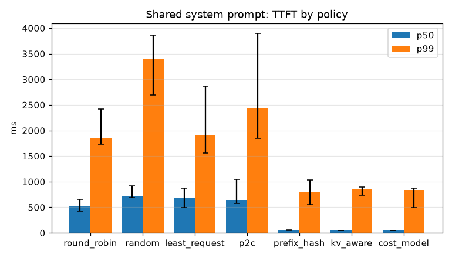

# Inferrail

[](https://github.com/jackeddisciple/Inferrail/actions/workflows/ci.yml)


Inferrail is a KV cache aware router and control plane for self hosted LLM
inference. It sits between OpenAI compatible clients and a fleet of vLLM or
SGLang engines, and sends every request to the replica that already holds
most of its prompt in cache, without letting any replica overload.

The goal is lower tail latency and fewer GPUs for the same traffic, proven
with benchmarks anyone can rerun.

> **Status: v0.1.9, the routing brain, hardened.** The gateway proxies
> chat and completions to a fleet of engines, streams responses untouched,
> retries before the first byte, ejects failing replicas, discovers
> replicas through DNS, reads every engine's load ten times a second,
> tokenizes prompts at the edge with token ids identical to vLLM's and
> predicts for every replica how much of each prompt it already holds. It
> now routes on those predictions: `cost_model` sends each request to the
> replica with the lowest estimated time to first token, inside load
> guards that keep any replica from melting, `kv_aware` and `prefix_hash`
> stand in for the weighted and hashing routers others ship,
> `inferrail-calibrate` measures the cost model on an engine, and
> `/admin/explain` shows why a replica won. See [Roadmap](#roadmap).

## Why this exists

Every LLM request has two phases. **Prefill** reads the whole prompt and
builds a key value cache; **decode** then produces tokens one at a time from
that cache. Engines like vLLM keep KV blocks in GPU memory after a request
finishes, so a later request with the same prefix skips most of its prefill.

That reuse only happens when the second request lands on the same replica.
Round robin and least connections ignore this: with N replicas a repeated
prefix finds a warm cache about 1/N of the time, and every miss pays for
prefill again in GPU time and time to first token (TTFT).

Prefix reuse is the normal case, not the exception:

* shared system prompts of thousands of tokens sent by every user,
* multi turn chat, where turn ten resends turns one to nine,
* agent loops that resend a growing context on every tool call,
* RAG over popular documents, and few shot evaluation batches.

The naive fixes fail in opposite directions. Hashing on the prefix piles a
hot system prompt onto one replica and melts it; pure load balancing throws
the cache away. Inferrail treats routing as a cost estimate instead: for each
replica, how long until this request's first token, given what is cached
there and what is queued there?

## What is in v0.1.9

| Piece | What it does |
| --- | --- |
| `inferrail-gateway` | OpenAI compatible proxy on hyper: chat and completions, streaming pass through, model list, request IDs, retries before the first byte, health checks, outlier ejection, breakers, DNS discovery, graceful shutdown, edge tokenization on a bounded worker pool, cache predictions per replica, a virtual prefill queue per replica, session keys, `/admin/explain`, Prometheus metrics on an admin port, OpenTelemetry traces and a sampled decision log |
| `inferrail-policy` | The `RoutingPolicy` trait and seven policies: the round robin, random, least request and power of two choices baselines, `prefix_hash` on rendezvous hashing, the weighted `kv_aware` score, and `cost_model`, the lowest estimated time to first token with bounded load, KV pressure, hot prefix replication and session affinity |
| `inferrail-calibrate` | Measures an idle engine's prefill with prompts of known cached and uncached length, timed by the engine's own histogram, and fits the cost model's parameters into a config fragment |
| `inferrail-tokenize` | Chat templates and Hugging Face tokenizers with token ids identical to vLLM v0.31.0 on three model families, a cache of repeated prompt pieces, the simulator's tokenizer, and chained XXH3 128 bit block hashes salted by model, adapter and `cache_salt` |
| `inferrail-index` | The KV index in approximate mode: a sharded map from block hash to replicas and a shadow LRU per replica sized to its KV capacity, with longest prefix lookup in microseconds |
| `inferrail-load` | Reads vLLM and SGLang `/metrics` pages, scrapes every replica ten times a second and publishes load snapshots that are never used once stale |
| `inferrail-control` | Lock free replica registry with request, prompt token and queued prefill counters, health state with exponential ejection backoff, the active health checker and DNS discovery |
| `inferrail-core` | Lossless OpenAI wire types, an incremental SSE decoder and validated YAML configuration |
| `inferrail-sim` | A CPU mock of vLLM v0.31.0 with the same HTTP API, streaming bytes and Prometheus metrics, a calibrated latency model and a real prefix cache |
| Other crates | `events` compiles as a stub with the boundaries the exact index will use |
| `bench/` | The benchmark harness (`inferrail-bench`): open loop workloads W1, W2 and W6 plus a mix of shared and unique prompts and Zipf hot system prompts, TTFT, TPOT and ITL measurement, prediction accuracy against the engines' own counts, replica shares, JSON results, charts and policy comparisons on simulators, plus the OpenAI SDK suites |
| `deploy/compose`, `dashboards/` | Gateway, simulators, Prometheus, Grafana and Jaeger in one `make stack`, with a dashboard that now shows estimated against measured TTFT, queued prefill and the load guards |
| CI | fmt, clippy with warnings denied, nextest, doc tests, ruff, pytest, `cargo audit`, `cargo machete`, and the official OpenAI SDK and the harness against the simulator and the gateway on every push |

## Quick start

Requirements: Rust (the pinned 1.98.1 toolchain installs itself through
rustup), [uv](https://docs.astral.sh/uv/) for the Python side, and optionally
[`cargo-nextest`](https://nexte.st).

Start three simulated engines and a gateway in front of them:

```sh
cargo build --release -p inferrail-sim -p inferrail-gateway -p inferrail-calibrate
for port in 8001 8002 8003; do
  ./target/release/inferrail-sim --port $port --enable-prompt-tokens-details &
done
./target/release/inferrail-gateway --config deploy/local.yaml
```

Talk to the gateway like any vLLM server. `sim` is an alias the gateway
resolves to `inferrail/sim-8b`:

```sh
curl -si localhost:8080/v1/chat/completions \
  -H 'content-type: application/json' \
  -d '{"model": "sim",
       "messages": [{"role": "user", "content": "Hello"}],
       "max_tokens": 16}'
```

The response headers name the replica that served it (`x-inferrail-replica`),
the request ID the engine used (`x-request-id`), the prompt's length in
tokens (`x-inferrail-prompt-tokens`) and, when the KV index made a
prediction, how many of them it predicted that replica had cached
(`x-inferrail-cached-tokens`); with
`--enable-prompt-tokens-details` the simulator reports the real count in
`usage.prompt_tokens_details.cached_tokens`. The official SDK works
by changing nothing but the base URL:

```python
from openai import OpenAI

client = OpenAI(base_url="http://localhost:8080/v1", api_key="unused")
stream = client.chat.completions.create(
    model="sim",
    messages=[{"role": "user", "content": "Hello"}],
    max_tokens=16,
    stream=True,
    stream_options={"include_usage": True},
)
for chunk in stream:
    print(chunk)
```

Ask the gateway why it would send a request where it would, without
sending it: the admin port answers with every replica's queue, predicted
cache and estimated time to first token, the winner and the term that
decided it.

```sh
curl -s localhost:9090/admin/explain/v1/chat/completions \
  -H 'content-type: application/json' \
  -d '{"model": "sim", "messages": [{"role": "user", "content": "Hello"}]}'
```

Measure an engine's prefill and get the cost model for it, ready to paste
under `routing` or a model's entry:

```sh
./target/release/inferrail-calibrate --url http://127.0.0.1:8001
```

Kill one of the simulators while traffic is flowing: only responses it was
already sending can break. The gateway retries every request that had not
started on another replica, ejects the dead one within milliseconds and
readmits it once it is back.
`inferrail-gateway --check --config <file>` validates a config and exits.

The gateway's metrics are on the admin port:

```sh
curl -s localhost:9090/metrics | grep inferrail_replica_engine
```

To see everything on a dashboard, bring up the full stack with Docker
(gateway, three simulators, Prometheus, Grafana and Jaeger):

```sh
make stack        # Grafana on :3000, gateway on :8080, Jaeger on :16686
make stack-down
```

To measure the gateway like a benchmark would, drive it open loop:

```sh
cd bench
uv run inferrail-bench run --base-url http://localhost:8080 --model sim \
  --workload w1 --rate 20 --requests 600 --out results/try/w1.json
uv run inferrail-bench plot results/try/w1.json --out report/try
```

## The gateway

**Routes.** `POST /v1/chat/completions` and `POST /v1/completions` are
proxied; `/v1/models` and `/health` are answered locally to GET and HEAD.
Other paths get a 404 and wrong methods a 405 with `Allow`, in the OpenAI
error shape vLLM uses. A rejected request that holds its body back behind
`Expect: 100-continue` is answered at once, without being asked to upload. HTTP/1.1 and h2c are accepted from clients; engines are reached
over pooled HTTP/1.1 keep alive connections, or h2c with `upstream.http2`.

**Pass through.** The request body is read once, within
`server.request_timeout` (a body that stops arriving gets a 408), and
forwarded byte for byte; only the `model` field is parsed. When a client asks for a gateway
alias, or omits the model while the gateway serves exactly one, only those
bytes are rewritten so the engine sees a name it serves. Responses stream
back frame by frame as they arrive, with headers intact except hop by hop
ones, and the gateway holds no per token state. Every response carries
`x-request-id` (the client's own when well formed, which vLLM also uses as
the response id), and proxied ones name their replica in
`x-inferrail-replica`. Request bodies are never logged unless
`logging.log_prompts` is on.

**Models.** `GET /v1/models` lists the configured models and aliases in
config order, with the metadata the engines published (context length,
root, permissions). The health checker refreshes those cards in the
background, so listing never calls an engine.

**Retries.** A request moves to another replica only before the first
response byte reaches the client: when the connection fails, the replica
closes before answering, it answers 502, 503 or 504, or it fails its health
checks while the request is still waiting for an answer. Untried replicas come
first, attempts stop at `retry.max_attempts` with exponential backoff, and
everything shares the `server.request_timeout` deadline. A stream that
breaks after it started is never replayed. The reasoning is in
[ADR 003](docs/adr/003-gateway-proxy-and-failure-semantics.md).

**Health and ejection.** Every replica is probed at `/health` each
`health.interval` and leaves rotation after `unhealthy_threshold` failed
probes. Independently, `unhealthy_threshold` consecutive failed requests
eject it for `ejection_backoff`, doubling on every repeat up to
`max_ejection_backoff`. Failed requests never eject more than
`max_ejection_percent` (half by default) of the replicas of a model that
pass their health checks, so requests that make every engine fail cannot
empty the pool. Under load a
crashed replica is out of rotation in milliseconds; it comes back once
probes pass and its window ends.

**Breakers.** `max_concurrency` caps requests in flight to a replica and
`max_pending` caps those still waiting for a response head. Caps never
overshoot, even under races. A full replica is skipped and a full fleet gets
an immediate 503 with `Retry-After`, so a replica that hangs stops absorbing
traffic instead of making every client wait.

**Discovery.** Replicas come from the config, from DNS groups, or both. Each
address a group name resolves to becomes a replica named
`<group>-<ip>-<port>`. Groups are resolved before the first request and then
every `refresh`; members that stay keep their health and counters, members
that leave finish their streams, and a failed lookup keeps the last known
set.

**Cancellation and shutdown.** A client that disconnects, whether streaming,
queued in the engine or waiting for a full response, frees the engine's slot
within 100 ms. Idle client connections are closed after
`server.header_read_timeout`. On SIGTERM the gateway stops accepting, lets
running streams finish for up to `server.shutdown_timeout`, then closes what
is left; a request a client sends on an idle connection at that very moment
can be lost, so put the gateway behind something that retries, or drain it
from the load balancer first.

## Load signals

The gateway knows two things about each replica's load. Its own counters
are always current: requests in flight, requests still waiting for a
response head, and prompt tokens in flight and still waiting for their first
byte (counted for models with a tokenizer, estimated at four bytes of
request body per token for the rest). The engine's own view comes from its Prometheus
page: running and waiting requests, KV cache usage, prefix cache counters,
preemptions and KV capacity.

**Engines.** vLLM v0.31.0 and SGLang v0.5.21 are read natively; the engine
is recognized by its metric prefix, data parallel ranks are summed, and
SGLang's per priority breakdowns are skipped. A page that lacks a required
family is reported as unreadable rather than taken as an idle engine, so a
renamed metric after an engine upgrade shows up in the scrape counters
instead of quietly skewing routing.

**Freshness.** Every replica is scraped in parallel every
`load.scrape_interval` (100 ms), each scrape bounded by
`load.scrape_timeout` and a 4 MiB page limit. A report older than
`load.max_age` (250 ms) is treated as missing: routing degrades to the
gateway's own counts instead of trusting stale numbers. A dead, hung or
garbage spewing engine is logged once when it stops answering and once when
it recovers, and never delays the other scrapes. Under 1,000 requests per
second the oldest report any reader saw was 102 ms; with 64 replicas
scraped at once it was 112 ms. See
[ADR 005](docs/adr/005-load-collector.md).

## Prompts and the KV index

To route on cache state the gateway has to know a prompt's tokens exactly
as the engine will see them, cut them into the blocks the engine caches,
and remember where each block went.

**Tokenization.** Each model names a tokenizer: a model directory, a
repository already in the local Hugging Face cache (`org/name` or
`org/name@revision`), or `builtin:sim` for the simulator. Nothing is
downloaded. Chat requests are prepared the way vLLM v0.31.0 prepares them,
rendered with the model's chat template on minijinja set up as transformers
sets up Jinja2, and tokenized with the pipeline transformers 5.17 builds,
which for `LlamaTokenizer` differs from `tokenizer.json`. `chat_template`,
`chat_template_content_format` and `chat_template_kwargs` mirror the vLLM
flags of the same names. What a template sees of a request is read with
the rules of Python's `json.loads`, template keywords reach the template
when Jinja2's own analysis says it reads them, and printed values and case
changes follow CPython 3.12. Golden fixtures for Qwen3, Granite 3.3 and
Hermes 2 Pro, generated by running vLLM's request handling through
transformers, match token for token. See
[ADR 008](docs/adr/008-tokenization-parity.md).

**Speed.** Repeated prompt pieces, such as shared system prompts and
earlier turns, are tokenized once per model and kept up to
`tokenizer.cache_tokens`. An 8,000 token chat takes 4.5 ms cold and 0.1 ms
when its system prompt was seen before. Bodies over 1 KiB go to a pool of
`tokenizer.workers` threads; a request that finds the queue full, or waits
longer than `tokenizer.max_wait`, is routed without a prediction instead of
waiting.

**Block hashes.** Full blocks of `block_size` tokens are hashed with
XXH3 128 in a chain, so a block's hash names its whole prefix; a trailing
partial block is never hashed. The chain is salted by the model, the LoRA
adapter and vLLM's per request `cache_salt`. Engine hash values are never
used. Hashing costs about 5.5 ns per block.

**The index.** Every routed prompt is recorded on the replica it went to, in
a shadow LRU as large as that replica's KV cache: `kv_capacity_blocks` when
set, else what its engine reports, else `index.default_capacity_blocks`.
What an attempt recorded is taken back when the engine refuses it, answers
with an error or fails before answering, since it never computed the prompt. A
shared map from block hash to replicas answers, for every candidate, how many
leading blocks of a prompt it holds: 2.4 µs for 512 blocks over 64
replicas. Predictions stop one block short of a fully cached prompt, as
engines always compute the last token. Replicas that leave the fleet are
forgotten, and an engine whose prefix cache counters go backwards is
treated as restarted with an empty cache. See
[ADR 009](docs/adr/009-approximate-kv-index.md).

**Degrading.** A model without a tokenizer, or whose tokenizer fails to load,
routes as before; startup and `--check` say so. A request the tokenizer
cannot follow (images, a template in the request, a batch of prompts) is
routed without a prediction and counted by reason.

## Observability

**Metrics.** `GET /metrics` on `server.admin_listen` (127.0.0.1:9090 by
default) serves OpenMetrics, apart from the client port:

| Metric | Labels | Meaning |
| --- | --- | --- |
| `inferrail_requests_total` | model, replica, status | inference requests by outcome: a status class, `aborted` when the engine broke a started response, `cancelled` when the client left |
| `inferrail_ttft_seconds` | model, policy, replica | arrival to first byte of a streamed response |
| `inferrail_request_duration_seconds` | model, policy, replica | arrival to the end of the response |
| `inferrail_routing_decisions_total` | model, policy, replica | the policy's choices, one per attempt |
| `inferrail_routing_decision_seconds` | policy | time to choose and take a lease |
| `inferrail_upstream_retries_total`, `inferrail_client_disconnects_total` | model | retries before the first byte, abandoned responses |
| `inferrail_request_errors_total` | model, reason | errors the gateway answered itself |
| `inferrail_tokenized_requests_total` | model, result | prompts tokenized, or why a request got no prediction: `invalid`, `unsupported`, `template`, `busy`, `slow`, `unavailable` |
| `inferrail_tokenize_seconds` | model | time to tokenize and hash a prompt, waiting for a worker included |
| `inferrail_prompt_tokens_total`, `inferrail_predicted_cached_tokens_total` | model | prompt tokens and the cached tokens predicted on the chosen replica, per decision |
| `inferrail_tokenize_cache_lookups_total` | model, result | repeated prompt pieces served from the tokenization cache |
| `inferrail_index_entries`, `inferrail_index_bytes`, `inferrail_index_resets_total` | replica for resets | blocks the index holds, its memory, engines found restarted |
| `inferrail_estimated_ttft_seconds` | model, policy | the cost model's estimate for the chosen replica, at every decision, to set against `inferrail_ttft_seconds` |
| `inferrail_routing_guards_total` | model, guard | decisions where `bounded_load` or `kv_pressure` set replicas aside, or `kv_waived` when every replica was under KV pressure |
| `inferrail_routing_steered_total` | model, reason | decisions decided by `session` affinity, landing on a `hot_prefix` owner, or routed by the `no_prefix` fallback |
| `inferrail_ejections_total`, `inferrail_load_scrapes_total` | replica (and result) | passive ejections, engine scrapes |
| `inferrail_replica_*` | replica | health, ejection, in flight requests and prompt tokens, queued prefill, the engine's running, waiting, KV usage and prefix cache counters, the age of its report, and the blocks and capacity the index assumes |

Replica gauges are read from the fleet when Prometheus scrapes, series of
replicas that leave are removed, and recording one streamed request costs
about 160 ns.

**Traces.** With `observability.otlp_endpoint` set, every request becomes a
server span, and every attempt a `route` span (policy, candidates offered,
winner, its in flight count and engine load, decision time, prompt tokens
and the winner's predicted cached tokens) and an
`upstream` client span, exported over OTLP HTTP and sampled by
`trace_sample_ratio`. A bare collector address such as
`http://collector:4318` gets the standard `/v1/traces` path. A client's
W3C `traceparent` is continued, and the engine receives the gateway's span
as its parent. Route spans also carry the winner's estimated time to first
token and what steered the decision. A warning is logged when export
starts failing and a note when it recovers. Without an endpoint the spans
are never created.

**Decision log.** With `observability.decision_log.sample_rate` above zero,
sampled requests write one JSON line per routing decision to
`decision_log.path`: the policy, the attempt, the prompt's tokens, the
winner, its estimated time to first token, what steered it and what the
guards set aside, and every candidate's state, load, queued prefill and
predicted cached tokens. Requests are sampled by id, so all attempts of
a request are kept together. A writer thread drains a bounded queue; if
the disk falls behind, records are dropped and counted, never waited for.
Prompts are never logged. See [ADR 006](docs/adr/006-observability.md).

**Dashboard.** `make stack` builds the gateway and simulator image and
brings up three simulators, the gateway, Prometheus, Grafana and Jaeger,
published on localhost only.
The provisioned dashboard ([`dashboards/inferrail.json`](dashboards/inferrail.json))
shows TTFT per replica and per policy from both the gateway and the
engines, in flight requests, engine queues and KV usage per replica, each
policy's traffic share, prefix cache hit rates, decision time, retries,
ejections and errors, and the predicted hit rate next to the engines' own,
tokenization outcomes and time, the blocks the index holds per replica, the
cost model's estimated TTFT next to the measured one, queued prefill per
replica, and how often the load guards and steering act.

## Routing

Every policy implements one `RoutingPolicy` trait and is chosen per model in
the config, so baselines and the main policy run in the same binary on the
same candidates. The gateway only ever offers a policy replicas that serve
the model, are healthy and have room. Each comes with its requests in
flight, the prompt tokens the KV index predicts it has cached, the prefill
work queued on it, its running requests and, while the engine's report is
fresh, its KV cache usage. The policy also sees the prompt's length and
block hashes and the conversation it belongs to. See
[ADR 004](docs/adr/004-routing-policies.md) and
[ADR 010](docs/adr/010-cost-model-routing.md).

| Policy | Rule |
| --- | --- |
| `round_robin` | next replica in turn |
| `random` | uniform choice |
| `least_request` | fewest requests in flight, ties broken at random |
| `p2c` | two random replicas, the less loaded wins |
| `prefix_hash` | rendezvous hash on the prompt's first `prefix_hash.blocks` blocks, whatever the load; power of two choices for prompts without a full block |
| `kv_aware` | best `cache_weight * cached / prompt - load_weight * in_flight / busiest`, ties to fewer requests in flight |
| `cost_model` | lowest estimated time to first token among the replicas the load guards allow |

**The cost model.** For each candidate `cost_model` estimates

```
TTFT = W + P(u, c) + X
P(u, c) = a*u + b*u*(c + u/2) + d
```

where `u` is the prompt tokens the replica would compute, `c` those it has
cached, and `a`, `b`, `d` come from `routing.cost_model` or the model's own
`cost_model`. `W` is the prefill already queued there plus
`decode_interference_secs` per running request. The gateway keeps that queue
itself: every routed request adds its estimated prefill to its replica's
queue, which drains in real time and counts as empty once every request on
the replica has had its first byte, so a replica of a fresh fleet costs
nothing to wait for and one with three long prompts ahead costs their
prefill. `X` prices cached tokens held in CPU or disk tiers by their load
time and only counts when loading beats recomputing; it is zero until the
index tracks tiers. Ties go to fewer requests in flight, then to chance.

**Load guards.** `cost_model` never picks a replica that

* would hold more than `ceil((1 + epsilon) * (in_flight + 1) / n)` requests,
  twice its share with the default `epsilon` of 1.0 (bounded load, after
  consistent hashing with bounded loads, so some replica always qualifies),
* reports more than `kappa` (0.92) of its KV cache in use, for a prompt with
  more than `short_prompt_tokens` (256) tokens to compute there, unless
  every replica does.

A root prefix (its first `hot_prefix.blocks` blocks) whose prefill demand,
counted in a decaying count min sketch over `hot_prefix.window`, needs
more than `hot_prefix.utilization` of a replica gets `ceil(demand /
utilization)` owners, priced as if they held the longest prefix an owner
holds that is that hot itself, so the cost model shares it among them by
their queues and a conversation's history counts only where it is. With
`session_affinity`, a request naming its conversation in `x-session-id` or
the `user` field goes back to the conversation's last replica while the
guards allow it. Why `epsilon` is 1.0 rather than the 0.25 the design
started from is in [ADR 011](docs/adr/011-load-guards.md), with the
measurements.

**Explaining a decision.** `POST /admin/explain/v1/chat/completions` (or
`/v1/completions`) on the admin port takes a request as a client would send
it and answers with what the model's policy would do now: the prompt's
length and blocks, every replica serving the model, whether it was offered
and why not, its load, queued prefill, predicted cache, any guard that set
it aside and its estimate, the winner, and the term (`queue`, `prefill` or
`tier_load`) that put it furthest ahead of the runner up. Nothing is routed
and no state changes; bodies are read as on the client port, within the
same timeout and size limit.

```json
{
  "policy": "cost_model",
  "prompt_tokens": 625,
  "winner": "r0",
  "decided_by": "prefill",
  "replicas": [
    {"replica": "r0", "cached_tokens": 592, "queued_secs": 0.0,
     "estimate": {"queue_secs": 0.0, "prefill_secs": 0.0084, "tier_secs": 0.0, "ttft_secs": 0.0084}},
    {"replica": "r1", "cached_tokens": 0, "queued_secs": 0.0,
     "estimate": {"queue_secs": 0.0, "prefill_secs": 0.0681, "tier_secs": 0.0, "ttft_secs": 0.0681}}
  ]
}
```

**Calibration.** `inferrail-calibrate --url <engine>` sends an idle engine
prompts of known cached and uncached length, one at a time, the cached part
sent alone first so the probe finds it cached. Each probe's TTFT comes from
the engine's own histogram (vLLM and SGLang export one), so network and
HTTP time stay out of the fit and are reported apart, and its cached tokens
from the engine's own prefix cache count, so an engine that cached less
than planned is fitted on what it computed. Every run sends fresh prompts
from its own seed, recorded in the output. A least squares fit
that keeps every term non negative gives `a`, `b` and `d`, printed or
written with `--out` as a `cost_model` fragment. Against the simulator it
recovers all three to nine significant digits.

**Cost.** Randomized policies are seeded from `routing.seed`, so a fixed
seed replays the same choices. A full `cost_model` decision for an 8,000
token prompt, the index lookup of every candidate included, takes 7 µs at
p99 over 64 replicas and 20 µs over 256 (benchmark A5, target 200 µs); a
baseline choice takes nanoseconds.

## The simulator

Real GPUs are rented, not owned, so most development and every CI run happen
against `inferrail-sim`. It has to be faithful enough that a router tuned on
it behaves the same on vLLM.

**Wire format.** Chat and completion responses, stream chunks, the usage
chunk, `data: [DONE]`, model cards and error bodies match vLLM v0.31.0 byte
for byte, including which fields are omitted and which are explicit `null`.
Request validation follows vLLM as well; for example a non empty
`stream_options` without `stream: true` is a 400. Parity tests compare the
simulator against fixtures derived from that version's source.

**Endpoints.** `POST /v1/chat/completions`, `POST /v1/completions`,
`GET /v1/models`, `GET /health`, `GET /metrics`, `GET /version` and
`POST /reset_prefix_cache`. An `x-request-id` header becomes the response id,
as in vLLM.

**Latency model.** One FIFO prefill queue on a virtual timeline, so
concurrent prompts wait for each other exactly as on a single GPU. Prefill
of `u` uncached tokens attending to `c` cached ones costs

```
P(u, c) = a*u + b*u*(c + u/2) + d
```

the same shape as the router's cost model, so calibration can recover the
parameters. Its TTFT and prefill time histograms are stamped when the model
produces the first token, as vLLM stamps them in its engine core, so they
carry no timer rounding. Decode emits tokens at a fixed time per output token, and
deadlines are planned ahead so timer overshoot never accumulates. The
defaults approximate an 8B model on one 24 GB GPU.

**Prefix cache.** Prompts are cut into full blocks, hashed as a chain so each
hash names its whole prefix, and kept in an O(1) LRU sized in blocks. Long
prefixes are evicted from the tail first, as vLLM frees them, and a fully
cached prompt still recomputes its last block.

**Tokenizer.** A deterministic stand in whose token boundaries depend only on
the text to their left, so shared text means shared tokens. Generated text
retokenizes to the same ids, so multi turn reuse works as it does on a real
engine. It lives in `inferrail-tokenize`, so a gateway configured with
`tokenizer: builtin:sim` tokenizes exactly as its simulators do.

**Metrics.** Every default vLLM family the simulator can model: running and
waiting requests, KV usage, prefix cache queries and hits, token counters,
finish reasons, TTFT, inter token latency, end to end, queue, prefill and
decode time histograms, with vLLM's names, help text, labels, buckets and
`prometheus_client` text format.

**Cancellation.** A client that disconnects, whether queued, prefilling or
streaming, releases its sequence slot and KV blocks immediately and is
counted as an abort.

Useful flags (all names follow vLLM where one exists):

| Flag | Default | Meaning |
| --- | --- | --- |
| `--served-model-name` | model path | names clients may request |
| `--block-size` | 16 | tokens per KV block |
| `--num-gpu-blocks-override` | 4096 | KV cache capacity in blocks |
| `--max-num-seqs` | 256 | running sequence cap |
| `--max-model-len` | 32768 | context length |
| `--enable-prompt-tokens-details` | off | report cached tokens in usage |
| `--prefill-token-us`, `--prefill-pair-ns`, `--prefill-fixed-ms` | 100, 3.3, 5 | `a`, `b` and `d` above |
| `--decode-token-ms` | 20 | time per output token |
| `--zero-latency` | off | answer as fast as possible, for overhead benchmarks |

Not modeled yet: decode interference inside a continuous batch, preemption,
KV events and caching of generated blocks. Requests that need `n > 1`,
logprobs, `echo` or `best_of` get a 400 naming the parameter instead of an
answer that silently differs from vLLM; stop strings are ignored.

## Benchmark harness

`bench/` holds `inferrail-bench`, which measures policies the way the
benchmark plan requires (see [ADR 007](docs/adr/007-benchmark-harness.md)):

* **Open loop.** Requests arrive on a seeded Poisson schedule and each is
  sent at its time whatever the earlier ones are doing. TTFT and end to end
  latency count from the scheduled time, and the gap between scheduled and
  actual send time is recorded, so a server that falls behind cannot hide
  its queueing.
* **Workloads.** W1: a handful of 2k to 8k token system prompts shared by
  every user, with 50 to 500 token questions. W2: multi turn chats whose
  history is resent each turn, each user thinking 10 to 20 s before the
  next question, generated or replayed from a ShareGPT file, each request
  naming its conversation in `x-session-id`. W6: prompts that share
  nothing, the control where cache affinity must not hurt. `mix`: W1 and
  W6 requests arriving together, half each, so a policy must weigh the
  cache one kind finds against the prefill the other queues. `hot`: W1
  with its system prompts drawn by Zipf weight (exponent 1.1), so a few
  are hot.
* **Measurements.** TTFT, time per output token, inter token latency, end
  to end latency, throughput, goodput against the default SLO (TTFT at most
  2 s, TPOT at most 100 ms), the prefix hit rate from usage and from the
  engines' own counters (read from vLLM or SGLang over the same requests,
  after the warmup), errors, send lag, requests per replica and the
  busiest replica's share. Time per output token counts tokens from usage,
  not stream chunks.
* **Prediction accuracy.** When the gateway tokenized a request, its
  predicted prompt and cached tokens are compared with the engine's usage:
  the share of exact predictions, of over and under predictions, the mean
  error in tokens and the predicted hit rate. Harness gateways tokenize
  with `builtin:sim`.
* **Fair comparisons.** `compare` gives every policy the same requests and
  arrival times and a cold gateway and simulators per run, discards a
  warmup, and repeats with new seeds.

```sh
make routing     # every policy on W1, W2, W6, mix and hot, 3 repetitions
make baselines   # the four cache blind baselines on W1, W2 and W6
make report      # charts and report.md from bench/results
```

The committed results in [`bench/results/routing`](bench/results/routing)
compare all seven policies on three simulators with the default latency
model of an 8B model on one 24 GB GPU, every run recorded from one clean
commit. Each workload runs at about 70% of what a cache blind fleet
sustains: W1 with 32 system prompts (more than one replica's KV cache
holds) at 6 req/s, W2 with users who think 10 to 20 s between turns at 25
req/s, W6 at 9 req/s, `mix` at 7 req/s and `hot` at 10 req/s. Medians over
three repetitions, TTFT p50 / p99 in ms:

| Policy | W1 | W1 hit rate | W2 | W6 | mix | hot | hot busiest replica |
| --- | --- | --- | --- | --- | --- | --- | --- |
| `round_robin` | 512 / 1,846 | 0.39 | 105 / 909 | 314 / 855 | 485 / 2,028 | 291 / 2,154 | 33% |
| `random` | 716 / 3,395 | 0.39 | 135 / 1,592 | 400 / 1,658 | 732 / 3,390 | 342 / 1,892 | 37% |
| `least_request` | 685 / 1,900 | 0.41 | 135 / 1,264 | 353 / 1,085 | 614 / 2,283 | 305 / 1,908 | 34% |
| `p2c` | 637 / 2,425 | 0.40 | 136 / 1,226 | 356 / 1,105 | 555 / 2,293 | 280 / 1,910 | 35% |
| `prefix_hash` | 52 / 792 | 0.89 | 109 / 1,446 | 400 / 1,931 | 363 / 2,156 | 55 / 950 | 47% |
| `kv_aware` | 51 / 845 | 0.88 | 115 / 1,307 | 352 / 1,057 | 299 / 1,295 | 52 / 896 | 38% |
| `cost_model` | 48 / 836 | 0.91 | 95 / 867 | 289 / 679 | 265 / 898 | 50 / 749 | 37% |
| `cost_model` with sessions | | | 112 / 1,534 | | | | |



What the numbers say:

* **Shared prompts.** Routing on the cache keeps 88 to 91% of W1's prompt
  tokens cached where every cache blind policy keeps about 40%, close to
  the one in three a replica's share of the traffic gives. `cost_model`
  cuts round robin's p99 TTFT by 55% (1,846 to 836 ms) and its median
  tenfold. `prefix_hash` has the lowest W1 p99, 792 ms, while putting 46%
  of the requests on one of three replicas.
* **Mixed traffic.** When long unique prompts arrive with shared ones,
  `cost_model` has a p99 TTFT 31% below `kv_aware` (898 against 1,295 ms)
  and 61% below `least_request`: requests in flight, the load `kv_aware`
  and the baselines see, are mostly decoding and say little about the
  prefill queued ahead of a new request.
* **No regression.** With nothing to share (W6), `cost_model` still has the
  lowest TTFT, 37% below `least_request` at p99, because queued prefill is
  the better load signal; `prefix_hash`, blind to load, is worst.
* **Hot prompts.** Under Zipf traffic `cost_model` has the lowest p99 and
  `prefix_hash` the most lopsided fleet, 47% of the requests on one
  replica.
* **Conversations.** With 10 to 20 s between turns most history is evicted
  before the next one, and every cache aware policy reuses about 10% of W2
  against 3%. `cost_model` has the best p50 and p99; `prefix_hash` and
  `kv_aware` pin conversations to replicas whatever their queues and raise
  p99. Session affinity does the same to `cost_model` (p99 867 to 1,534
  ms): the index already finds each conversation's history, so on the
  simulator affinity adds nothing over cache scoring and costs tail
  latency.

No run lost a request, the gateway's prediction matched the engine's cached
tokens on all but 2 of 64,263 requests, the engines' own hit rates match the
ones measured from usage, and the client sent every request within 3 ms of
its schedule at p99. The full report, with distributions, hit rates and replica
shares for every workload, is in
[`bench/report/routing/report.md`](bench/report/routing/report.md); the
earlier comparison of the baselines alone is in
[`bench/report/baselines/report.md`](bench/report/baselines/report.md).

## Configuration

The gateway reads one YAML file. Only `models` and at least one replica or
DNS group are required; everything else has a safe default, unknown keys are
rejected, and every problem is reported at once with its path.

```yaml
models:
  - name: meta-llama/Llama-3.1-8B-Instruct
    aliases: [llama-8b]
    policy: least_request
    tokenizer: /models/Llama-3.1-8B-Instruct
    chat_template_kwargs:
      enable_thinking: false
replicas:
  - id: gpu-0
    url: http://10.0.0.10:8000
    models: [meta-llama/Llama-3.1-8B-Instruct]
    max_concurrency: 256
    max_pending: 32
    kv_capacity_blocks: 18000
discovery:
  dns:
    - name: llama-pool
      url: http://vllm.inference.svc.cluster.local:8000
      models: [meta-llama/Llama-3.1-8B-Instruct]
      refresh: 2s
routing:
  default_policy: cost_model
  epsilon: 1.0
  kappa: 0.92
  session_affinity: true
  seed: 42
  cost_model:
    prefill_token_secs: 0.0001
    prefill_pair_secs: 0.0000000033
    prefill_fixed_secs: 0.005
health:
  interval: 1s
  timeout: 500ms
  unhealthy_threshold: 3
  ejection_backoff: 5s
retry:
  max_attempts: 3
  backoff: 25ms
load:
  scrape_interval: 100ms
  max_age: 250ms
tokenizer:
  workers: 4
  max_wait: 50ms
index:
  default_capacity_blocks: 16384
observability:
  otlp_endpoint: http://localhost:4318/v1/traces
  trace_sample_ratio: 0.1
  decision_log:
    path: /var/log/inferrail/decisions.jsonl
    sample_rate: 0.01
```

See [`deploy/inferrail.example.yaml`](deploy/inferrail.example.yaml) for every
option with its default, and [`deploy/local.yaml`](deploy/local.yaml) for the
quick start fleet.

## Testing

`make check` runs formatting, clippy with warnings denied, ruff, every Rust
test and the Python tests. `make audit` checks dependencies against the
RustSec advisory database and for unused crates. Beyond unit tests the suite
includes:

* **Golden parity**: token ids for 648 requests across Qwen3, Granite 3.3
  and Hermes 2 Pro equal what vLLM v0.31.0 computes with transformers
  5.17, with tools, multi turn conversations, reasoning, documents, content
  parts, special tokens in text and continued messages, cold and warm, with
  and without the tokenization cache.
* **Template compatibility**: the variables a template reads, found as
  Jinja2 finds them on real chat templates, numbers read as `json.loads`
  reads them, and `repr`, `title` and `capitalize` checked against CPython
  3.12, each with the expectations Python itself produced.
* **Property tests** for SSE decoding under any chunking, tokenizer prefix
  stability, block hash chaining (a changed token changes its block and
  every later one, never an earlier one; a prefix hashes the same alone or
  inside a longer prompt), the KV index against a naive reference model
  after any sequence of records, records taken back, clears and departures
  (a reported prefix of depth d means blocks 0 to d minus 1 are held and
  block d is not),
  arbitrary request bodies never panicking the tokenizers, the prefix cache LRU, latency
  monotonicity, config round trips, uniform policy choices under fixed seeds,
  least request always picking a minimum, power of two choices never picking
  a unique maximum, fleet membership, replica health and lease token
  counters against naive reference models, the request splice changing
  nothing but the model, metrics pages that never crash the parser, and
  rendered pages that always parse back to the reference totals.
* **Routing invariants**: across any random sequence of arrivals and
  departures, with sessions and hot prefixes in play, `cost_model` never
  gives a replica more than `ceil((1 + epsilon) * average)` requests; some
  replica is always within the cap; explaining never changes the next
  choice, and whenever it names a winner, routing picks that replica with
  the same steer and guards; more cache never costs more and a tier hit
  never costs more than ignoring it; the count min sketch never
  underestimates; the calibration fit recovers random parameters through
  noise. The worked example of the design (a cached replica behind a long
  queue loses to an idle cold one, and wins once the cold one is busier) is
  a test.
* **Fleet simulations** (`crates/inferrail-policy/tests/fleet.rs`): every
  policy routing the same seeded traffic over replicas that prefill at the
  simulator's speed and evict their prefix caches. The cache aware policies
  keep at least 80% of W1's prompt tokens cached where round robin keeps
  37%; `cost_model` has a 26% lower p99 TTFT than `kv_aware` on a mix of
  shared and unique prompts; under Zipf traffic it puts at most 29% of
  requests on one of four replicas where `prefix_hash` puts 39%; and a hot
  system prompt that sends `prefix_hash` past 20 s at p99 leaves it under
  0.3 s. Multi turn chats over one hot system prompt keep their hit rate
  and p99 with hot prefix replication on, as with it off.
* **Gateway invariants**: no policy ever routes to an unhealthy replica or
  one that does not serve the model; bytes the engine sends reach the client
  unchanged under any chunking; request bodies reach the engine byte for
  byte; no request, however malformed, gets a gateway failure; a request
  succeeds whenever a healthy replica is within its attempts; every request
  is counted in exactly one metrics outcome; metrics of departed replicas
  never outlive them, even when requests race their removal.
* **Fuzzing**: random wire payloads must round trip, random engine schedules
  must keep FIFO admission and clean accounting, random HTTP requests must
  get responses that obey the vLLM contract, and hostile YAML fails fast.
* **Integration tests** against three in process simulators that can be
  killed for real or made to refuse, close, hang, delay or fail on demand:
  routing, retries, ejection and readmission, DNS joins and leaves, breakers,
  disconnects, graceful shutdown, header timeouts and log hygiene; load
  snapshots that stay under 250 ms old, engines that die or serve hostile
  metrics pages; every metric and its labels (a snapshot test), span
  attributes and trace propagation through an in memory exporter, real OTLP
  export from the binary, and the decision log.
* **Consistency tests**: every dashboard query names a metric the gateway or
  vLLM exports, and the compose stack and its configs are valid.
* **Prediction tests**: predicted cached tokens equal what three simulators
  really cached on every one of 300 requests under eviction pressure,
  through streams and completions, with capacity learned from engine
  metrics, after an engine restart, and when a tokenizer cannot load.
* **Routing tests** against in process simulators: the cache aware
  policies serve 92 to 95% of shared prompt tokens from cache where round
  robin serves 37%; sessions stick to their replica until it is overloaded
  and then follow the new one; queued prefill is estimated while it waits
  and drains after; `/admin/explain` output is a snapshot, sends nothing to
  any engine, and marks replicas that were unhealthy or full.
* **Calibration tests**: `inferrail-calibrate` against simulators with two
  different parameter sets recovers `a`, `b` and `d` within 5%, with every
  probe's engine time equal to the latency model to a microsecond, and
  does so again on a second run against the same simulator and against one
  that caches nothing.
* **Harness tests**: workload shapes and determinism, Poisson statistics,
  TTFT, TPOT and ITL against servers with known timing, coordinated
  omission against a server that falls behind, a blocked client loop
  showing up as lag, prediction accuracy, results, reports and a full
  comparison on real binaries.
* **SDK tests** (`make e2e`): the official OpenAI Python SDK, sync and async,
  against the simulator binary and through the gateway binary in front of
  three simulators.
* **Stress tests** (`make stress`), on an Apple silicon laptop with client,
  gateway and simulators sharing one machine:

| Scenario | Result |
| --- | --- |
| 2,000 concurrent streams through the gateway over 3 simulators | all complete in 0.3 to 0.7 s, zero errors, even spread |
| Open loop at 2,000 and 5,000 req/s, 10,000 requests each, with metrics and load scraping on | the gateway adds about 0.1 ms at p50 and under 0.25 ms at p99 |
| The same at 5,000 req/s with the decision log at full sampling and traces exported to an unreachable collector | the gateway adds 0.15 ms at p50 and 0.34 ms at p99; 15,000 decisions logged, none dropped |
| A simulator killed under 1,000 req/s, then restarted | zero errors for requests sent after the kill, ejected within 10 ms, back in rotation within 60 ms |
| A replica that hangs, with requests waiting on it | they move to another replica as soon as probes mark it down |
| Requests that make every engine fail | at most half the replicas are ejected; the pool never empties |
| A replica flapping between healthy and 503 every 100 ms at 1,000 req/s | zero client errors |
| 1,000 streams with 741 random disconnects | every disconnect aborted in the engine, nothing leaked |
| 3,000 hostile requests | zero gateway failures |
| 35,000 request soak through the gateway | resident memory grew under 10 MB |
| 640 MiB streamed to 20 clients that stop reading | about 20 MB held in total |
| An 8 MiB request body sent in one byte chunks | about 11 MB held while it arrives |
| 1,000 concurrent streams through the async SDK, direct and via the gateway | all complete with exact usage |
| 2,000 concurrent SSE streams straight to one simulator | all complete in 0.55 s, zero errors |
| 35,000 request simulator soak | resident memory grew under 20 MB |
| Engine load reports under 1,000 req/s through 3 simulators | every reader saw a report under 102 ms old (p99 100 ms); never stale |
| 64 replicas scraped every 100 ms under 2,000 req/s | oldest report 112 ms, zero errors |
| `/metrics` scraped 100 times a second during 2,000 concurrent streams | every stream completes; counters and histograms consistent on every scrape |
| 20 replicas serving 50 MB or endless metrics pages for 5 s | the healthy replica's report never older than 104 ms; each scrape capped at 4 MiB and 100 ms |
| 8,000 replicas churned through discovery | the metrics page never exceeds 40 KB and renders in 0.05 ms |
| The harness driving zero latency simulators at 300 req/s | every request sent within 2.2 ms of its schedule at p99 |
| Open loop at 2,000 and 5,000 req/s with tokenization and the index on, 200 word system prompts | the gateway adds 0.3 to 0.5 ms at p99 |
| The same with 2,000 word system prompts at 1,000 and 2,000 req/s | the gateway adds 0.3 to 0.5 ms at p99 |
| 3,000 requests at 400 req/s over 3 simulators | every prompt and cached token prediction exact |
| 400 concurrent 20,000 word prompts through one tokenizer worker | all served; those that could not wait were routed without a prediction |
| 40,000 distinct prompts soaked through the index | it stays within the replicas' KV capacity, RSS grew 43 MB |
| 12 threads recording, 6 looking up and 2 forgetting for 5 s | the shared map equals the shadow caches exactly afterwards; lookup p99 31 µs |
| A million blocks over 64 replicas | 148 bytes per block, 512 block lookups at 7 µs p99 |
| 16 threads sharing one tokenizer and its cache | 20 to 33 million tokens per second, every id exact |
| 4 MB messages, 50,000 messages, 1,000 tools, nested arguments | each tokenized or refused within half a second |
| 9,621 more golden requests | every token id matches |
| A full `cost_model` decision for an 8,000 token prompt, index lookup included, 20,000 times | p99 6.5 µs at 8 replicas, 7 µs at 64, 20 µs at 256 |
| 16 threads sharing one policy of each kind, sessions and hot prefixes in play | 800,000 decisions each, every one valid |
| Open loop at 2,000 and 5,000 req/s over 8 replicas with each cache aware policy, three runs | decisions under 50 µs at p99; the gateway adds 0.2 to 0.4 ms at p50, and its p99, 0.9 to 3.4 ms with client, gateway and eight simulators on one laptop, varies as much between runs as between policies |
| 4,000 requests at 400 req/s over 4 simulators, Zipf over 16 system prompts, 300 sessions, explain requests mixed in | the busiest replica took 26.6 to 27.3%; 97 to 98% of each session's turns stayed on its replica; zero errors |

The suite runs clean ten times in a row with every core saturated.

## Repository layout

```
crates/
  inferrail-core/        wire types, SSE codec, configuration
  inferrail-gateway/     the router: proxy, retries, health, metrics, traces
  inferrail-policy/      routing policy trait and baseline policies
  inferrail-control/     replica registry, health, ejection, DNS discovery
  inferrail-load/        engine metrics parsing, scraping, load snapshots
  inferrail-sim/         mock vLLM engine (binary and library)
  inferrail-tokenize/    chat templates, tokenizers, block hashing
  inferrail-index/       KV block index
  inferrail-events/      engine KV event subscribers
  inferrail-calibrate/   engine profiler that fits the cost model
bench/                   benchmark harness and the OpenAI SDK suites
  results/               raw results of committed runs
  report/                charts and reports generated from them
dashboards/              Grafana dashboard JSON
deploy/                  example, local and compose configurations
tests/fixtures/          OpenAI, vLLM and SGLang payloads, tokenizer goldens
docs/adr/                architecture decision records
```

## Roadmap

The aim is a router that serves the same traffic at the same latency target
with fewer GPUs than a cache blind balancer, while adding under 1 ms of its
own latency. Every number below is a target to prove or disprove with
committed, rerunnable benchmarks, not a claim.

* **Gateway and baselines.** Shipped in v0.1.2: OpenAI compatible proxy,
  zero copy streaming, retries before the first byte, health checks, outlier
  ejection, breakers, DNS discovery, cancellation, and four baseline
  policies behind one trait.
* **Load signals and observability.** Shipped in v0.1.4: vLLM and SGLang
  metrics scraped ten times a second and merged with the gateway's own
  counts, Prometheus metrics, OpenTelemetry traces with routing attributes,
  a sampled decision log, a Grafana dashboard, and a benchmark harness that
  compares the baselines on the simulator.
* **Tokens, hashes and the approximate index.** Shipped in v0.1.6: chat
  templates and tokenizers with token ids identical to vLLM's, chained
  XXH3 128 bit block hashes salted by model, adapter and `cache_salt`, and a
  KV index built from the router's own decisions that predicts every
  replica's cached prefix.
* **The routing brain.** Shipped in v0.1.8: `prefix_hash` and `kv_aware`
  as the cache aware baselines, and `cost_model`, estimated TTFT per replica
  as queued prefill plus prefill of uncached tokens plus tier load time,
  with bounded load, KV pressure guards, hot prefix replication and optional
  session affinity, `inferrail-calibrate` to fit it to an engine, and
  `/admin/explain` to show why a replica won.
* **Realistic simulation.** Continuous batching, prefill and decode
  interference, preemption and KV events in the simulator, more workloads
  and one command for the full sweep.
* **Exact index.** An exact mode fed by engine KV events over ZMQ, with gap
  detection and fallback to the approximate mode.
* **Production controls.** SLO aware admission, token based rate limits,
  hot reload, shadow mode, API keys and TLS.
* **Advanced regimes.** Disaggregated prefill and decode pools, tiered KV
  cache across GPU, CPU and disk, and Kubernetes packaging.
* **Proof.** A benchmark report against cache blind baselines on synthetic
  workloads and replayed production traces, with targets such as p99 router
  overhead under 1 ms, 80% or better prefix hit rate on shared prompts, 40%
  lower p99 TTFT than round robin, and at least one GPU saved per four.

## License

MIT. See [LICENSE](LICENSE).
