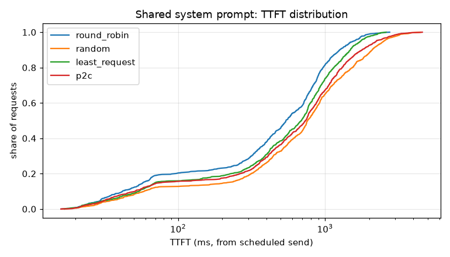
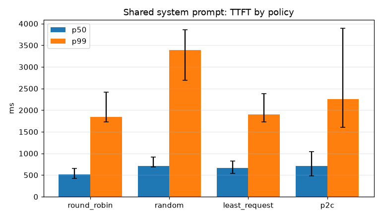
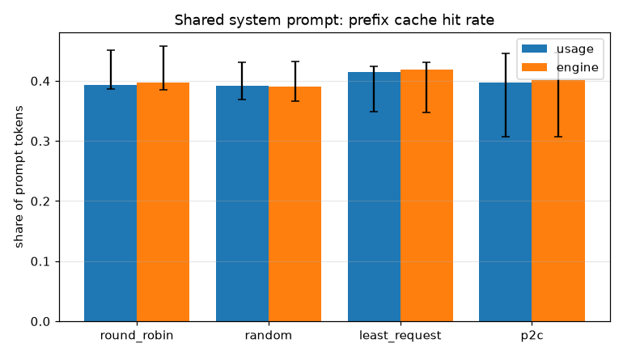
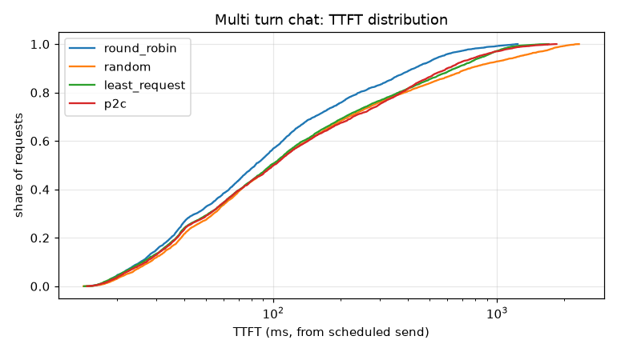
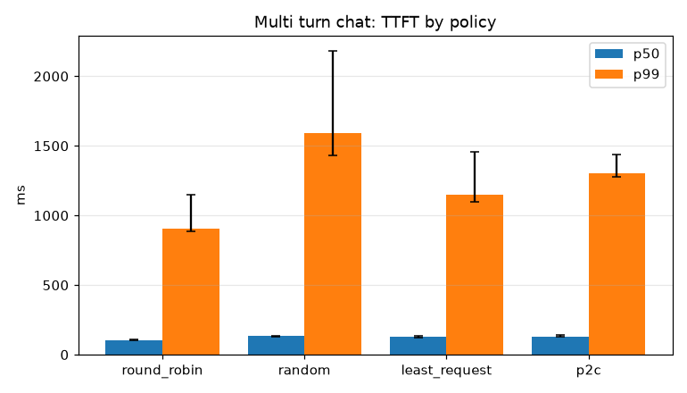
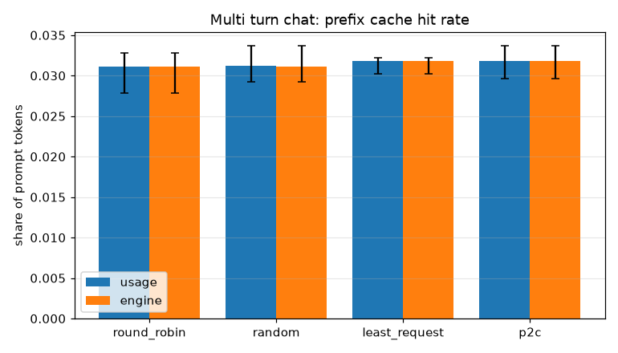
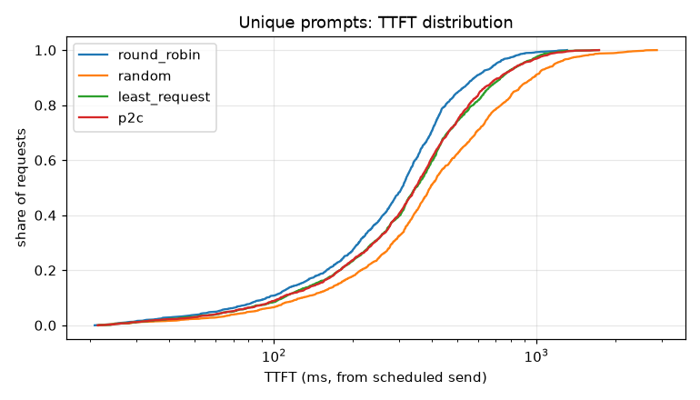
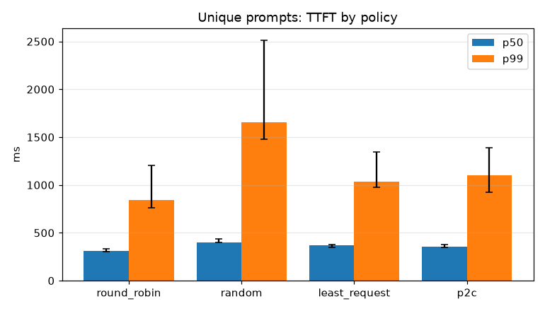
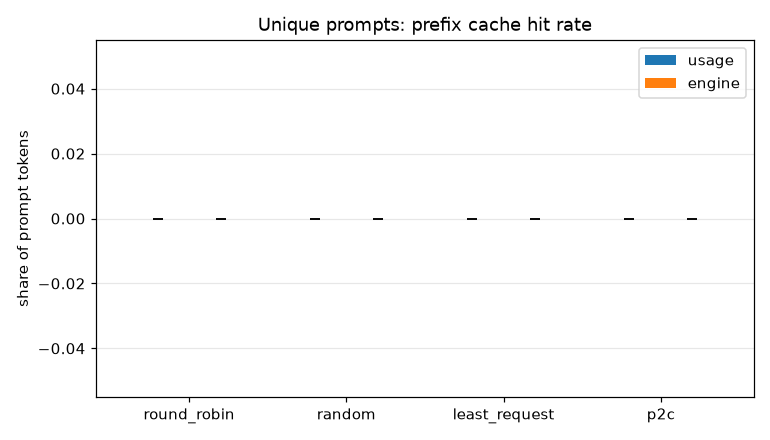

# Policy comparison

Medians over repetitions, with the range in brackets when they differ.
Latencies count from each request's scheduled send time.

## W1: Shared system prompt

360 requests at 6.0 req/s, 3 repetitions, seed 0.

| policy | TTFT p50 ms | TTFT p99 ms | TPOT p50 ms | ITL p99 ms | goodput req/s | hit rate | engine hit rate | errors | send lag p99 ms |
|---|---|---|---|---|---|---|---|---|---|
| round_robin | 510 [422, 653] | 1843 [1733, 2413] | 20.0 | 21.5 [21.4, 21.5] | 5.89 [5.83, 5.93] | 0.39 [0.39, 0.45] | 0.40 [0.39, 0.46] | 0 | 1.3 [1.1, 1.4] |
| random | 712 [691, 913] | 3392 [2690, 3857] | 20.0 | 21.4 | 5.29 [5.04, 5.32] | 0.39 [0.37, 0.43] | 0.39 [0.37, 0.43] | 0 | 1.2 [1.2, 1.3] |
| least_request | 670 [533, 825] | 1899 [1732, 2386] | 20.0 | 21.4 | 5.80 [5.72, 5.91] | 0.42 [0.35, 0.42] | 0.42 [0.35, 0.43] | 0 | 1.2 [1.1, 1.4] |
| p2c | 708 [477, 1041] | 2256 [1600, 3895] | 20.0 | 21.5 [21.4, 21.5] | 5.68 [4.76, 5.93] | 0.40 [0.31, 0.45] | 0.40 [0.31, 0.45] | 0 | 1.3 [1.3, 1.8] |

## W2: Multi turn chat

1500 requests at 25.0 req/s, 3 repetitions, seed 0.

| policy | TTFT p50 ms | TTFT p99 ms | TPOT p50 ms | ITL p99 ms | goodput req/s | hit rate | engine hit rate | errors | send lag p99 ms |
|---|---|---|---|---|---|---|---|---|---|
| round_robin | 104 [101, 111] | 906 [885, 1152] | 20.0 | 21.5 [21.2, 21.8] | 24.72 [24.27, 25.08] | 0.03 | 0.03 | 0 | 1.4 [1.1, 2.2] |
| random | 134 [127, 136] | 1589 [1430, 2182] | 20.0 | 21.5 [21.2, 21.9] | 24.72 [23.57, 25.08] | 0.03 | 0.03 | 0 | 1.3 [1.1, 2.8] |
| least_request | 127 [122, 134] | 1146 [1096, 1456] | 20.0 | 21.5 [21.2, 21.5] | 24.72 [24.27, 25.08] | 0.03 | 0.03 | 0 | 1.4 [1.2, 1.4] |
| p2c | 131 [131, 141] | 1301 [1278, 1437] | 20.0 | 21.5 [21.2, 21.6] | 24.72 [24.27, 25.08] | 0.03 | 0.03 | 0 | 1.3 [1.1, 1.6] |

## W6: Unique prompts

540 requests at 9.0 req/s, 3 repetitions, seed 0.

| policy | TTFT p50 ms | TTFT p99 ms | TPOT p50 ms | ITL p99 ms | goodput req/s | hit rate | engine hit rate | errors | send lag p99 ms |
|---|---|---|---|---|---|---|---|---|---|
| round_robin | 313 [302, 330] | 846 [762, 1201] | 20.0 | 22.0 [22.0, 22.1] | 9.01 [8.71, 9.06] | 0.00 | 0.00 | 0 | 1.9 [1.6, 2.0] |
| random | 397 [397, 434] | 1656 [1476, 2513] | 20.0 | 22.0 [21.9, 22.0] | 8.71 [8.67, 9.04] | 0.00 | 0.00 | 0 | 1.8 [1.7, 1.9] |
| least_request | 369 [345, 375] | 1034 [977, 1345] | 20.0 | 22.0 [22.0, 22.2] | 9.01 [8.71, 9.06] | 0.00 | 0.00 | 0 | 1.9 [1.4, 2.2] |
| p2c | 352 [346, 379] | 1105 [927, 1390] | 20.0 | 22.0 | 9.01 [8.71, 9.06] | 0.00 | 0.00 | 0 | 1.7 [1.4, 2.1] |

