# Policy comparison

Medians over repetitions, with the range in brackets when they differ.
Latencies count from each request's scheduled send time.

## HOT: Hot system prompts

600 requests at 10.0 req/s, 3 repetitions, seed 0.

| policy | TTFT p50 ms | TTFT p99 ms | TPOT p50 ms | ITL p99 ms | goodput req/s | hit rate | engine hit rate | prediction agreement | max replica share | errors | send lag p99 ms |
|---|---|---|---|---|---|---|---|---|---|---|---|
| round_robin | 291 [214, 584] | 2154 [1681, 2572] | 20.0 | 22.0 | 9.84 [9.47, 10.03] | 0.64 [0.63, 0.67] | 0.64 [0.63, 0.67] | 1.00 | 0.33 | 0 | 1.6 [1.5, 1.6] |
| random | 342 [279, 691] | 1892 [1807, 3766] | 20.0 | 22.0 | 9.94 [9.21, 10.03] | 0.66 [0.65, 0.68] | 0.66 [0.64, 0.68] | 1.00 | 0.37 [0.36, 0.37] | 0 | 1.6 [1.4, 1.7] |
| least_request | 305 [276, 400] | 1908 [1510, 2262] | 20.0 | 22.0 [21.9, 22.0] | 9.97 [9.90, 10.00] | 0.65 [0.64, 0.66] | 0.65 [0.64, 0.66] | 1.00 | 0.34 [0.34, 0.35] | 0 | 1.8 [1.5, 1.8] |
| p2c | 280 [268, 518] | 1910 [1480, 2375] | 20.0 | 22.0 | 9.90 [9.88, 10.03] | 0.66 [0.65, 0.67] | 0.66 [0.65, 0.67] | 1.00 | 0.35 | 0 | 1.7 [1.6, 1.7] |
| prefix_hash | 55 [53, 56] | 950 [774, 1145] | 20.0 | 22.0 | 10.05 [10.00, 10.17] | 0.87 [0.86, 0.89] | 0.87 [0.86, 0.89] | 1.00 | 0.47 | 0 | 1.7 [1.5, 1.7] |
| kv_aware | 52 [51, 53] | 896 [818, 1211] | 20.0 | 22.0 [21.9, 22.0] | 10.05 [10.00, 10.17] | 0.88 | 0.88 | 1.00 | 0.38 [0.37, 0.39] | 0 | 1.7 [1.4, 2.0] |
| cost_model | 50 [49, 51] | 749 [678, 886] | 20.0 | 21.9 [21.9, 22.0] | 10.05 [10.00, 10.17] | 0.87 [0.86, 0.89] | 0.87 [0.86, 0.89] | 1.00 | 0.37 [0.34, 0.39] | 0 | 1.6 [1.5, 1.7] |

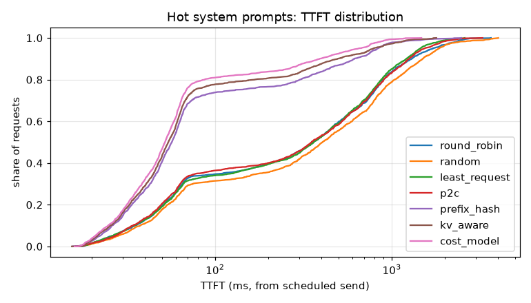
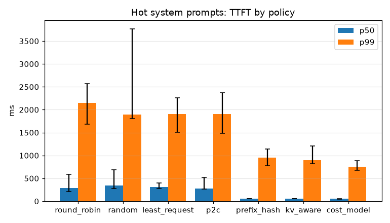
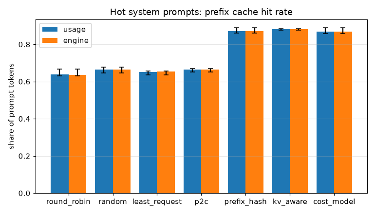

## MIX: Shared and unique prompts

420 requests at 7.0 req/s, 3 repetitions, seed 0.

| policy | TTFT p50 ms | TTFT p99 ms | TPOT p50 ms | ITL p99 ms | goodput req/s | hit rate | engine hit rate | prediction agreement | max replica share | errors | send lag p99 ms |
|---|---|---|---|---|---|---|---|---|---|---|---|
| round_robin | 485 [433, 562] | 2028 [1707, 2633] | 20.0 | 22.1 [21.3, 22.2] | 6.92 [6.75, 6.97] | 0.19 [0.17, 0.20] | 0.19 [0.17, 0.20] | 1.00 | 0.34 | 0 | 1.4 [1.2, 1.5] |
| random | 732 [692, 933] | 3390 [2711, 3485] | 20.0 | 22.1 | 6.16 [5.76, 6.32] | 0.17 [0.16, 0.18] | 0.17 [0.16, 0.19] | 1.00 | 0.35 [0.35, 0.36] | 0 | 1.8 [1.7, 2.1] |
| least_request | 614 [519, 822] | 2283 [1991, 2434] | 20.0 | 22.1 | 6.86 [6.81, 7.00] | 0.17 | 0.17 | 1.00 | 0.35 [0.34, 0.36] | 0 | 1.9 [1.7, 2.0] |
| p2c | 555 [500, 708] | 2293 [1874, 2958] | 20.0 | 22.1 | 6.79 [6.71, 6.92] | 0.18 [0.17, 0.19] | 0.18 [0.18, 0.19] | 1.00 | 0.34 | 0 | 2.0 [1.9, 2.1] |
| prefix_hash | 363 [314, 367] | 2156 [1418, 2215] | 20.0 | 22.1 | 6.94 [6.91, 7.04] | 0.47 [0.42, 0.47] | 0.47 [0.42, 0.48] | 1.00 | 0.40 [0.39, 0.44] | 0 | 1.7 [1.5, 1.8] |
| kv_aware | 299 [264, 304] | 1295 [1038, 1854] | 20.0 | 22.1 [22.0, 22.1] | 7.05 [6.94, 7.16] | 0.47 [0.42, 0.49] | 0.48 [0.42, 0.49] | 1.00 | 0.35 [0.34, 0.36] | 0 | 1.8 [1.7, 1.9] |
| cost_model | 265 [234, 282] | 898 [766, 1306] | 20.0 | 22.1 | 7.05 [6.94, 7.18] | 0.46 [0.40, 0.46] | 0.46 [0.40, 0.46] | 1.00 | 0.34 [0.34, 0.35] | 0 | 2.0 [1.6, 2.0] |

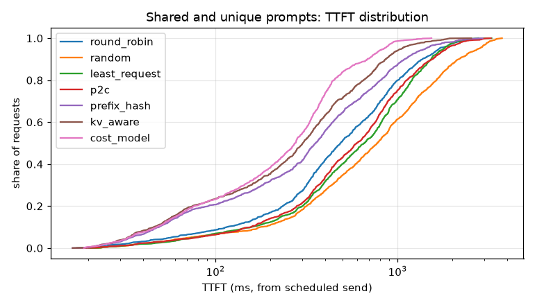
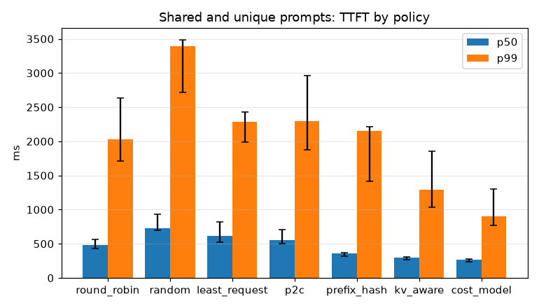
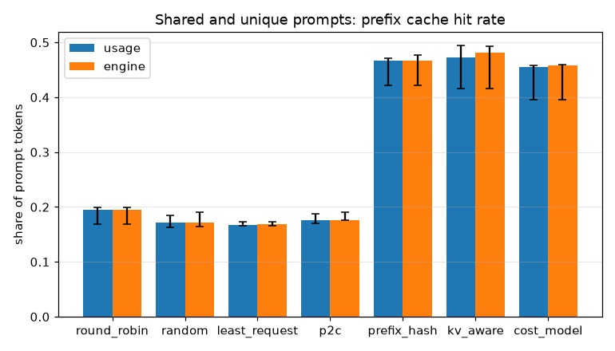

## W1: Shared system prompt

360 requests at 6.0 req/s, 3 repetitions, seed 0.

| policy | TTFT p50 ms | TTFT p99 ms | TPOT p50 ms | ITL p99 ms | goodput req/s | hit rate | engine hit rate | prediction agreement | max replica share | errors | send lag p99 ms |
|---|---|---|---|---|---|---|---|---|---|---|---|
| round_robin | 512 [425, 654] | 1846 [1736, 2415] | 20.0 | 22.2 | 5.89 [5.83, 5.93] | 0.39 [0.39, 0.45] | 0.40 [0.39, 0.46] | 1.00 | 0.33 | 0 | 2.2 [1.8, 2.2] |
| random | 716 [693, 918] | 3395 [2691, 3861] | 20.0 | 22.1 | 5.29 [5.04, 5.32] | 0.39 [0.37, 0.43] | 0.39 [0.37, 0.43] | 1.00 | 0.34 [0.34, 0.35] | 0 | 2.1 |
| least_request | 685 [495, 872] | 1900 [1563, 2865] | 20.0 | 22.1 [22.1, 22.2] | 5.80 [5.50, 5.91] | 0.41 [0.35, 0.42] | 0.41 [0.35, 0.42] | 1.00 | 0.34 [0.34, 0.35] | 0 | 2.0 [2.0, 2.2] |
| p2c | 637 [568, 1041] | 2425 [1851, 3897] | 20.0 | 22.2 [22.1, 22.2] | 5.72 [4.76, 5.91] | 0.40 [0.31, 0.42] | 0.40 [0.31, 0.43] | 1.00 | 0.35 | 0 | 2.2 [1.9, 2.3] |
| prefix_hash | 52 [43, 57] | 792 [546, 1027] | 20.0 | 22.1 | 5.93 [5.85, 6.05] | 0.89 [0.86, 0.92] | 0.89 [0.86, 0.92] | 1.00 | 0.46 [0.41, 0.47] | 0 | 2.1 [1.8, 2.2] |
| kv_aware | 51 [44, 52] | 845 [733, 895] | 20.0 | 22.1 | 5.93 [5.85, 6.05] | 0.88 [0.88, 0.91] | 0.88 [0.88, 0.91] | 1.00 | 0.36 [0.34, 0.36] | 0 | 2.1 [2.0, 2.2] |
| cost_model | 48 [44, 49] | 836 [493, 871] | 20.0 | 22.1 [22.1, 22.2] | 5.93 [5.85, 6.05] | 0.91 [0.90, 0.92] | 0.91 [0.90, 0.92] | 1.00 | 0.35 [0.35, 0.36] | 0 | 2.0 [1.9, 2.1] |

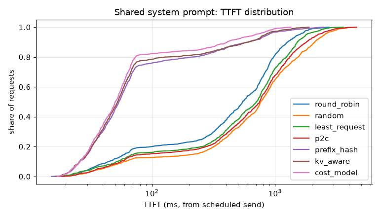

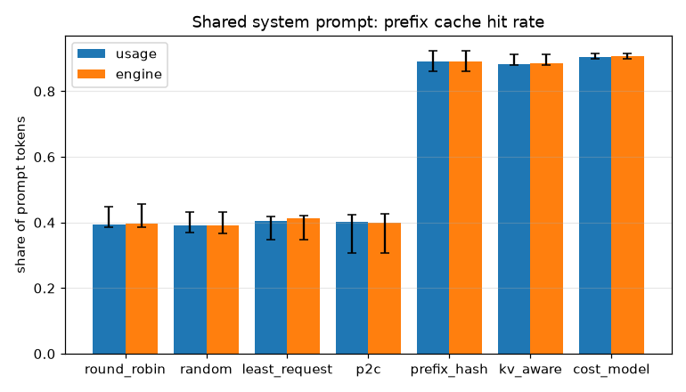

## W2: Multi turn chat

1500 requests at 25.0 req/s, 3 repetitions, seed 0.

| policy | TTFT p50 ms | TTFT p99 ms | TPOT p50 ms | ITL p99 ms | goodput req/s | hit rate | engine hit rate | prediction agreement | max replica share | errors | send lag p99 ms |
|---|---|---|---|---|---|---|---|---|---|---|---|
| round_robin | 105 [102, 112] | 909 [883, 1154] | 20.0 | 21.8 | 24.72 [24.27, 25.08] | 0.03 | 0.03 | 1.00 | 0.33 | 0 | 1.9 [1.7, 2.1] |
| random | 135 [127, 139] | 1592 [1428, 2185] | 20.0 | 21.8 | 24.72 [23.57, 25.08] | 0.03 | 0.03 | 1.00 | 0.36 | 0 | 2.1 [1.8, 2.5] |
| least_request | 135 [119, 150] | 1264 [1106, 1408] | 20.0 | 21.8 [21.8, 21.9] | 24.72 [24.27, 25.08] | 0.03 | 0.03 | 1.00 | 0.34 | 0 | 2.1 [1.9, 2.4] |
| p2c | 136 [124, 137] | 1226 [1201, 1366] | 20.0 | 21.8 | 24.72 [24.27, 25.08] | 0.03 | 0.03 | 1.00 | 0.34 | 0 | 2.2 [1.8, 2.2] |
| prefix_hash | 109 [109, 122] | 1446 [1377, 2046] | 20.0 | 21.8 | 24.72 [24.00, 25.08] | 0.10 | 0.10 | 1.00 | 0.36 [0.35, 0.37] | 0 | 2.0 [2.0, 2.7] |
| kv_aware | 115 [109, 134] | 1307 [1048, 1338] | 20.0 | 21.8 | 24.72 [24.27, 25.08] | 0.10 | 0.10 | 1.00 | 0.34 | 0 | 2.1 [2.1, 2.2] |
| cost_model | 95 [91, 102] | 867 [737, 1088] | 20.0 | 21.8 [21.7, 21.8] | 24.72 [24.27, 25.08] | 0.09 [0.08, 0.09] | 0.09 [0.08, 0.09] | 1.00 | 0.34 [0.33, 0.34] | 0 | 1.8 [1.8, 2.0] |
| cost_model+sessions | 112 [107, 113] | 1534 [1146, 2045] | 20.0 | 21.8 [21.8, 21.9] | 24.36 [24.27, 25.08] | 0.10 | 0.10 | 1.00 | 0.35 [0.34, 0.35] | 0 | 2.0 [2.0, 2.2] |

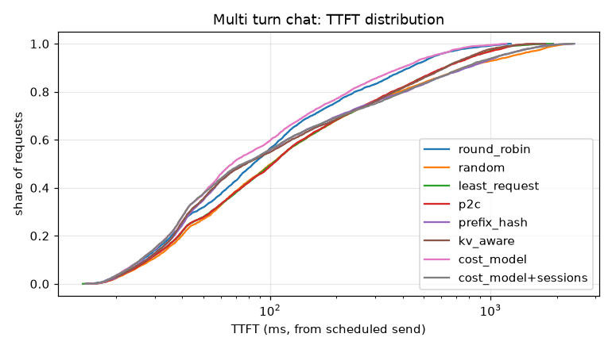
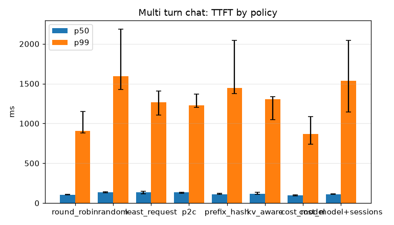
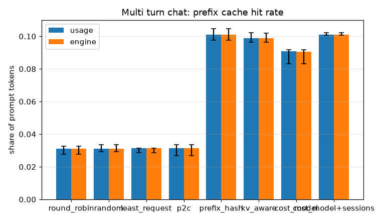

## W6: Unique prompts

540 requests at 9.0 req/s, 3 repetitions, seed 0.

| policy | TTFT p50 ms | TTFT p99 ms | TPOT p50 ms | ITL p99 ms | goodput req/s | hit rate | engine hit rate | prediction agreement | max replica share | errors | send lag p99 ms |
|---|---|---|---|---|---|---|---|---|---|---|---|
| round_robin | 314 [301, 332] | 855 [847, 1202] | 20.0 | 22.0 | 9.01 [8.71, 9.06] | 0.00 | 0.00 | 1.00 | 0.33 | 0 | 1.7 [1.6, 1.8] |
| random | 400 [397, 437] | 1658 [1478, 2514] | 20.0 | 22.0 | 8.71 [8.67, 9.04] | 0.00 | 0.00 | 1.00 | 0.36 | 0 | 1.6 [1.5, 1.8] |
| least_request | 353 [346, 376] | 1085 [949, 1347] | 20.0 | 22.0 [21.9, 22.0] | 9.01 [8.71, 9.06] | 0.00 | 0.00 | 1.00 | 0.34 [0.33, 0.35] | 0 | 1.8 [1.5, 2.1] |
| p2c | 356 [346, 391] | 1105 [1088, 1471] | 20.0 | 22.0 [21.9, 22.0] | 9.01 [8.71, 9.06] | 0.00 | 0.00 | 1.00 | 0.34 | 0 | 1.7 [1.6, 1.9] |
| prefix_hash | 400 [390, 432] | 1931 [1241, 2613] | 20.0 | 22.1 [21.3, 22.1] | 8.77 [8.71, 8.98] | 0.00 | 0.00 | 1.00 | 0.35 [0.35, 0.36] | 0 | 1.5 [1.3, 1.7] |
| kv_aware | 352 [344, 381] | 1057 [989, 1392] | 20.0 | 22.0 [21.3, 22.0] | 9.01 [8.71, 9.06] | 0.00 | 0.00 | 1.00 | 0.34 | 0 | 1.6 [1.1, 1.8] |
| cost_model | 289 [282, 306] | 679 [635, 1077] | 20.0 | 22.0 [21.3, 22.0] | 9.01 [8.71, 9.06] | 0.00 | 0.00 | 1.00 | 0.35 [0.34, 0.36] | 0 | 2.0 [1.1, 2.0] |

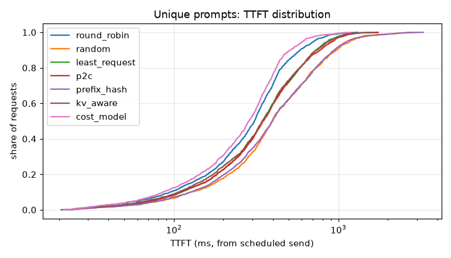
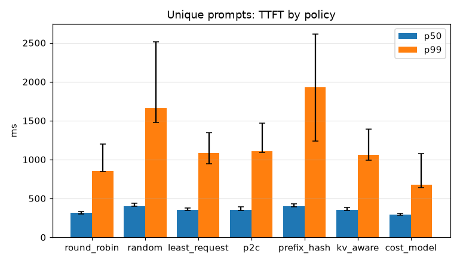
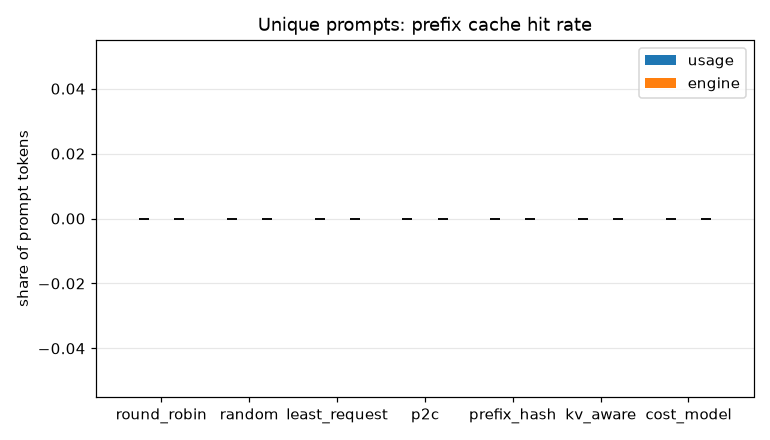
