# Simulator sweep

Every policy ran on the same requests and arrival times on a fresh gateway and fresh simulators. Medians over repetitions, with the range in brackets when they differ; latencies count from each request's scheduled send time.

## Milestone and targets

**cost_model beats least_request on W1 to W3: met.**
* W1 (w1): p99 TTFT 994 ms against 4135 ms (-76%), goodput 5.93 against 4.44 req/s: met.
* W2 (w2): p99 TTFT 409 ms against 756 ms (-46%), goodput 14.99 against 14.99 req/s: met.
* W3 (w3): p99 TTFT 1524 ms against 8030 ms (-81%), goodput 3.03 against 1.88 req/s: met.

* Engine prefix hit rate on W1, target 80%+: 88%.
* p99 TTFT on W1 against round robin, target 40%+ lower: 72%.
* p99 TTFT on unique prompts (W6) against least_request, target within 5%: -36%.
* Goodput against least_request, target 30%+ higher: +44% median over points, best +1040%.

## Headline

Each point at its main rate, the middle of a rate sweep.

| point | workload | rate | p99 TTFT ms, cost_model | vs least_request | vs round_robin | goodput vs least_request | hit rate | best p99 |
|---|---|---|---|---|---|---|---|---|
| hot | hot | 10 | 989 | -72% | -73% | +10% | 0.87 | cost_model |
| mix | mix | 7 | 1200 | -72% | -73% | +44% | 0.44 | cost_model |
| w1 | w1 | 6 | 994 | -76% | -72% | +34% | 0.88 | cost_model |
| w1-knee | w1 | 6 | 926 | -78% | -73% | +53% | 0.90 | cost_model |
| w2 | w2 | 15 | 409 | -46% | -17% | +0% | 0.23 | cost_model |
| w3 | w3 | 3 | 1524 | -81% | -83% | +61% | 0.88 | cost_model |
| w3-knee | w3 | 3 | 1526 | -85% | -83% | +46% | 0.88 | cost_model |
| w4 | w4 | 9 | 512 | -33% | -14% | +0% | 0.25 | cost_model |
| w5 | w5 | 12 | 92 | +1% | +10% | +0% | 0.94 | round_robin |
| w6 | w6 | 9 | 909 | -36% | -38% | +1% | 0.00 | cost_model |
| w8-cv2 | w8 | 5 | 1012 | -85% | -83% | +192% | 0.85 | cost_model |
| w8-cv4 | w8 | 5 | 1398 | -91% | -92% | +1040% | 0.87 | cost_model |
| w8-poisson | w8 | 5 | 1024 | -85% | -85% | +112% | 0.85 | cost_model |

## hot: Hot system prompts

Poisson arrivals, 3 repetitions per rate, seed 0.

### 10 req/s, 600 requests

| policy | TTFT p50 ms | TTFT p99 ms | TPOT p50 ms | ITL p99 ms | goodput req/s | hit rate | engine hit rate | prediction agreement | max replica share | errors | send lag p99 ms |
|---|---|---|---|---|---|---|---|---|---|---|---|
| round_robin | 567 [412, 3072] | 3613 [2711, 8951] | 48.2 [42.3, 71.5] | 264.3 [264.0, 274.3] | 8.81 [3.82, 8.95] | 0.63 [0.60, 0.67] | 0.63 [0.61, 0.67] | 0.94 [0.93, 0.96] | 0.33 | 0 | 3.0 [2.1, 3.2] |
| random | 625 [515, 2445] | 3132 [2850, 8863] | 45.3 [44.9, 65.5] | 267.2 [263.1, 276.1] | 8.98 [4.70, 9.25] | 0.65 [0.63, 0.67] | 0.65 [0.63, 0.68] | 0.94 [0.93, 0.96] | 0.37 [0.36, 0.37] | 0 | 3.9 [2.2, 4.0] |
| least_request | 499 [410, 1744] | 3489 [2029, 6349] | 48.6 [45.0, 70.0] | 262.6 [260.5, 275.7] | 9.17 [5.31, 9.61] | 0.63 [0.63, 0.65] | 0.63 [0.63, 0.65] | 0.94 [0.94, 0.96] | 0.35 [0.34, 0.36] | 0 | 3.5 [2.6, 3.6] |
| p2c | 454 [431, 2905] | 2430 [2134, 7669] | 45.5 [43.8, 77.3] | 262.6 [259.1, 276.5] | 9.59 [2.99, 9.83] | 0.64 [0.62, 0.67] | 0.64 [0.62, 0.67] | 0.95 [0.93, 0.95] | 0.36 | 0 | 3.0 [2.8, 3.4] |
| prefix_hash | 93 [89, 93] | 1245 [1022, 1612] | 26.2 [25.7, 27.0] | 246.4 [245.2, 254.1] | 10.05 [9.98, 10.17] | 0.86 [0.85, 0.88] | 0.86 [0.85, 0.88] | 0.98 | 0.47 | 0 | 3.2 [2.1, 3.3] |
| kv_aware | 87 [86, 87] | 1121 [1063, 1511] | 24.5 [24.1, 24.6] | 118.0 [106.1, 236.3] | 10.05 [10.00, 10.17] | 0.88 [0.87, 0.89] | 0.88 [0.87, 0.89] | 0.98 [0.98, 0.99] | 0.37 [0.36, 0.37] | 0 | 2.8 [2.1, 3.5] |
| cost_model | 84 [83, 85] | 989 [858, 1009] | 24.5 [24.4, 24.7] | 235.7 [222.8, 236.8] | 10.05 [10.00, 10.17] | 0.87 [0.85, 0.88] | 0.87 [0.85, 0.88] | 0.98 | 0.38 [0.36, 0.40] | 0 | 2.1 [2.1, 2.7] |

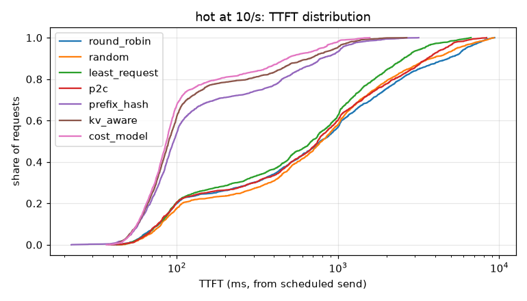
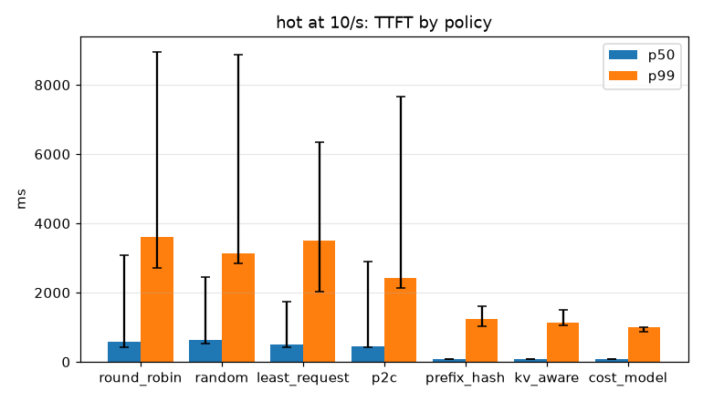

## mix: Shared and unique prompts

Poisson arrivals, 3 repetitions per rate, seed 0.

### 7 req/s, 420 requests

| policy | TTFT p50 ms | TTFT p99 ms | TPOT p50 ms | ITL p99 ms | goodput req/s | hit rate | engine hit rate | prediction agreement | max replica share | errors | send lag p99 ms |
|---|---|---|---|---|---|---|---|---|---|---|---|
| round_robin | 1089 [762, 1780] | 4492 [2718, 5644] | 77.5 [64.7, 87.3] | 262.2 [259.9, 270.0] | 4.16 [2.84, 5.93] | 0.19 [0.16, 0.21] | 0.19 [0.15, 0.21] | 0.96 [0.96, 0.97] | 0.34 | 0 | 3.2 [3.1, 4.3] |
| random | 1382 [1213, 2283] | 6250 [4472, 6318] | 78.4 [78.0, 85.8] | 265.9 [261.1, 268.9] | 3.79 [2.17, 3.84] | 0.18 [0.18, 0.19] | 0.18 [0.18, 0.19] | 0.95 [0.94, 0.96] | 0.35 [0.35, 0.36] | 0 | 3.3 [3.2, 3.6] |
| least_request | 1039 [825, 1712] | 4277 [3075, 6743] | 78.1 [68.5, 91.6] | 264.4 [259.6, 269.1] | 4.87 [2.49, 5.89] | 0.18 [0.16, 0.19] | 0.17 [0.17, 0.18] | 0.97 [0.95, 0.97] | 0.37 [0.34, 0.37] | 0 | 3.3 [3.1, 3.5] |
| p2c | 1081 [983, 2123] | 4070 [2926, 5674] | 71.9 [64.9, 86.6] | 262.5 [260.6, 268.6] | 5.08 [2.35, 5.93] | 0.19 [0.16, 0.20] | 0.20 [0.16, 0.20] | 0.97 [0.95, 0.97] | 0.34 [0.34, 0.35] | 0 | 3.5 [2.7, 3.6] |
| prefix_hash | 524 [471, 529] | 3075 [2815, 3887] | 44.0 [39.5, 46.4] | 258.1 [254.0, 259.8] | 6.12 [6.07, 6.57] | 0.45 [0.38, 0.45] | 0.45 [0.38, 0.46] | 0.95 [0.95, 0.96] | 0.40 [0.39, 0.44] | 0 | 2.9 [2.8, 3.1] |
| kv_aware | 409 [375, 445] | 1321 [1264, 2320] | 38.3 [34.0, 39.6] | 249.8 [248.2, 256.1] | 6.95 [6.94, 7.03] | 0.48 [0.40, 0.48] | 0.47 [0.40, 0.48] | 0.97 [0.96, 0.99] | 0.34 [0.34, 0.35] | 0 | 2.9 [2.6, 3.0] |
| cost_model | 353 [326, 383] | 1200 [1042, 1685] | 40.3 [36.8, 40.5] | 247.5 [245.0, 257.7] | 7.01 [6.94, 7.16] | 0.44 [0.39, 0.46] | 0.44 [0.39, 0.46] | 0.98 [0.96, 0.98] | 0.35 [0.34, 0.35] | 0 | 3.3 [2.8, 12.4] |

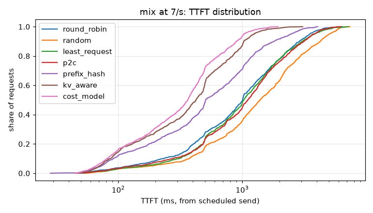
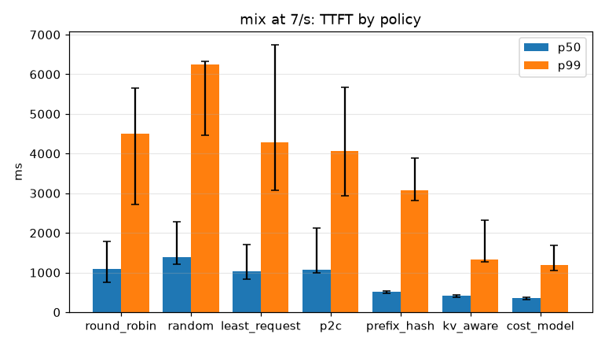

## w1: Shared system prompt

Poisson arrivals, 3 repetitions per rate, seed 0.

### 6 req/s, 360 requests

| policy | TTFT p50 ms | TTFT p99 ms | TPOT p50 ms | ITL p99 ms | goodput req/s | hit rate | engine hit rate | prediction agreement | max replica share | errors | send lag p99 ms |
|---|---|---|---|---|---|---|---|---|---|---|---|
| round_robin | 991 [668, 1879] | 3498 [2962, 5574] | 60.0 [50.2, 74.7] | 266.3 [259.1, 271.7] | 4.86 [2.96, 5.51] | 0.41 [0.39, 0.42] | 0.41 [0.39, 0.42] | 0.89 [0.89, 0.90] | 0.33 | 0 | 2.9 [2.5, 4.6] |
| random | 1467 [998, 2415] | 6431 [5078, 6782] | 70.5 [56.4, 71.7] | 268.2 [260.7, 271.2] | 3.48 [2.29, 4.06] | 0.40 [0.39, 0.40] | 0.39 [0.39, 0.41] | 0.92 [0.90, 0.93] | 0.34 [0.34, 0.35] | 0 | 3.8 [3.0, 5.1] |
| least_request | 1167 [678, 3646] | 4135 [2160, 6296] | 65.3 [42.5, 81.4] | 269.4 [258.1, 271.1] | 4.44 [1.48, 5.73] | 0.39 [0.36, 0.44] | 0.39 [0.36, 0.44] | 0.91 [0.88, 0.91] | 0.34 [0.34, 0.37] | 0 | 3.0 [2.8, 3.3] |
| p2c | 1299 [741, 3201] | 4949 [3023, 6458] | 67.5 [51.3, 82.9] | 266.4 [258.6, 270.9] | 3.52 [1.65, 5.43] | 0.39 [0.36, 0.40] | 0.39 [0.36, 0.40] | 0.91 | 0.35 [0.34, 0.38] | 0 | 2.7 [2.6, 2.9] |
| prefix_hash | 84 [78, 90] | 1112 [611, 1546] | 22.3 [22.0, 23.8] | 235.1 [76.8, 246.0] | 5.93 [5.85, 6.05] | 0.88 [0.84, 0.92] | 0.88 [0.84, 0.92] | 0.96 [0.93, 0.98] | 0.46 [0.41, 0.47] | 0 | 2.4 [2.3, 2.6] |
| kv_aware | 82 [77, 83] | 1044 [779, 1089] | 22.1 [21.8, 22.1] | 81.1 [73.2, 82.2] | 5.93 [5.85, 6.05] | 0.89 [0.87, 0.89] | 0.89 [0.87, 0.89] | 0.96 [0.94, 0.99] | 0.35 [0.34, 0.35] | 0 | 2.5 [2.3, 2.5] |
| cost_model | 85 [78, 86] | 994 [567, 995] | 22.1 [21.7, 22.4] | 88.9 [74.7, 136.2] | 5.93 [5.85, 6.05] | 0.88 [0.84, 0.92] | 0.88 [0.85, 0.92] | 0.96 [0.95, 0.99] | 0.36 [0.35, 0.37] | 0 | 2.6 [2.3, 3.8] |

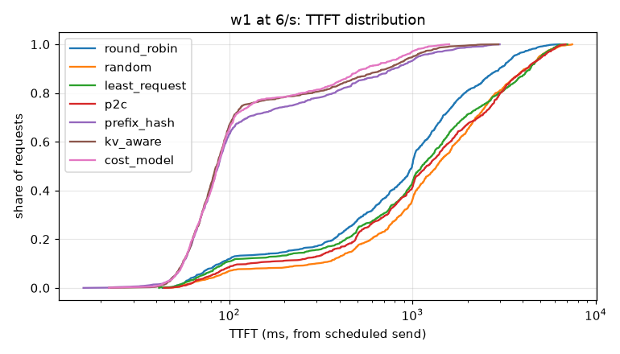
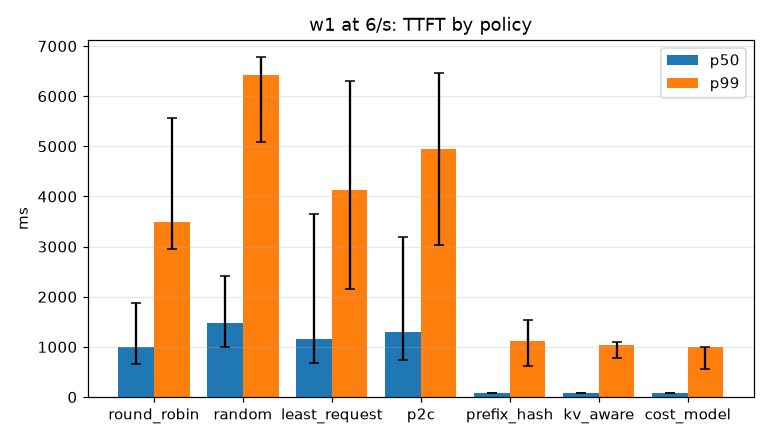

## w1-knee: Shared system prompt

Poisson arrivals, 3 repetitions per rate, seed 0.

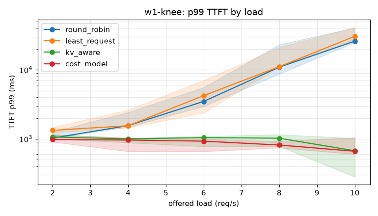
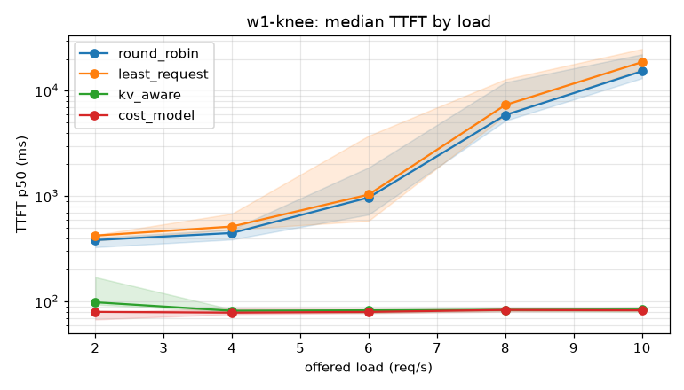
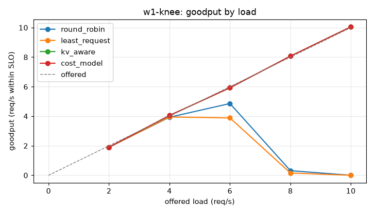

### 2 req/s, 120 requests

| policy | TTFT p50 ms | TTFT p99 ms | TPOT p50 ms | ITL p99 ms | goodput req/s | hit rate | engine hit rate | prediction agreement | max replica share | errors | send lag p99 ms |
|---|---|---|---|---|---|---|---|---|---|---|---|
| round_robin | 383 [328, 403] | 1028 [1015, 1262] | 21.0 [20.5, 22.7] | 238.2 [225.0, 243.4] | 1.90 [1.77, 2.05] | 0.41 [0.37, 0.45] | 0.41 [0.37, 0.45] | 0.96 [0.93, 0.97] | 0.34 [0.33, 0.34] | 0 | 2.4 [2.3, 2.4] |
| least_request | 422 [378, 429] | 1329 [1225, 1471] | 20.6 [20.4, 21.4] | 238.3 [231.0, 238.6] | 1.90 [1.77, 2.05] | 0.37 [0.36, 0.38] | 0.36 [0.35, 0.38] | 0.97 [0.96, 0.98] | 0.34 [0.34, 0.35] | 0 | 2.5 [2.4, 2.6] |
| kv_aware | 98 [94, 170] | 1064 [1002, 1160] | 20.2 [20.2, 20.3] | 47.2 [40.8, 56.2] | 1.90 [1.77, 2.05] | 0.60 [0.54, 0.65] | 0.59 [0.53, 0.65] | 0.98 [0.95, 1.00] | 0.35 [0.34, 0.37] | 0 | 2.5 [2.4, 14.7] |
| cost_model | 80 [68, 80] | 978 [904, 1150] | 20.4 [20.3, 20.6] | 58.0 [42.4, 64.4] | 1.90 [1.77, 2.05] | 0.74 [0.74, 0.80] | 0.73 [0.73, 0.80] | 1.00 [0.96, 1.00] | 0.37 [0.36, 0.43] | 0 | 2.4 [2.4, 2.5] |

### 4 req/s, 240 requests

| policy | TTFT p50 ms | TTFT p99 ms | TPOT p50 ms | ITL p99 ms | goodput req/s | hit rate | engine hit rate | prediction agreement | max replica share | errors | send lag p99 ms |
|---|---|---|---|---|---|---|---|---|---|---|---|
| round_robin | 447 [388, 485] | 1557 [1486, 2431] | 31.7 [31.0, 37.7] | 258.1 [248.9, 260.6] | 3.93 [3.91, 4.05] | 0.41 [0.38, 0.44] | 0.40 [0.38, 0.43] | 0.92 [0.92, 0.93] | 0.33 | 0 | 2.4 [2.4, 2.6] |
| least_request | 515 [481, 682] | 1550 [1451, 2627] | 32.5 [30.5, 34.4] | 258.5 [248.2, 261.6] | 3.95 [3.79, 4.05] | 0.39 [0.38, 0.41] | 0.39 [0.38, 0.41] | 0.94 [0.94, 0.96] | 0.34 [0.34, 0.36] | 0 | 2.5 [2.4, 2.6] |
| kv_aware | 82 [80, 84] | 1000 [880, 1032] | 21.2 [21.1, 21.3] | 72.6 [72.2, 72.8] | 4.05 [3.95, 4.18] | 0.81 [0.81, 0.86] | 0.81 [0.80, 0.85] | 0.98 [0.97, 0.98] | 0.35 [0.35, 0.36] | 0 | 2.6 [2.4, 2.6] |
| cost_model | 79 [76, 86] | 961 [658, 1031] | 21.3 [21.1, 21.4] | 74.9 [67.7, 87.2] | 4.05 [3.95, 4.18] | 0.84 [0.84, 0.89] | 0.84 [0.83, 0.89] | 0.98 [0.96, 0.99] | 0.36 | 0 | 2.6 [2.4, 4.5] |

### 6 req/s, 360 requests

| policy | TTFT p50 ms | TTFT p99 ms | TPOT p50 ms | ITL p99 ms | goodput req/s | hit rate | engine hit rate | prediction agreement | max replica share | errors | send lag p99 ms |
|---|---|---|---|---|---|---|---|---|---|---|---|
| round_robin | 971 [669, 1871] | 3490 [2961, 5571] | 60.3 [50.2, 74.8] | 266.5 [258.1, 270.5] | 4.86 [2.98, 5.51] | 0.41 [0.39, 0.41] | 0.41 [0.39, 0.42] | 0.89 [0.89, 0.90] | 0.33 | 0 | 3.0 [2.9, 3.3] |
| least_request | 1036 [584, 3739] | 4227 [2383, 7051] | 54.6 [43.5, 83.8] | 266.5 [257.1, 270.7] | 3.88 [1.89, 5.69] | 0.43 [0.33, 0.45] | 0.43 [0.33, 0.45] | 0.91 [0.90, 0.92] | 0.34 [0.34, 0.37] | 0 | 3.1 [3.1, 3.9] |
| kv_aware | 83 [78, 83] | 1043 [776, 1090] | 22.1 [21.8, 22.1] | 80.4 [71.4, 82.6] | 5.93 [5.85, 6.05] | 0.89 [0.87, 0.89] | 0.89 [0.87, 0.89] | 0.96 [0.94, 0.99] | 0.35 [0.34, 0.35] | 0 | 2.6 [2.4, 2.8] |
| cost_model | 80 [78, 85] | 926 [656, 996] | 22.0 [21.8, 22.1] | 79.9 [74.7, 88.2] | 5.93 [5.85, 6.05] | 0.90 [0.88, 0.91] | 0.90 [0.88, 0.91] | 0.98 [0.95, 0.99] | 0.35 [0.34, 0.37] | 0 | 2.4 |

### 8 req/s, 480 requests

| policy | TTFT p50 ms | TTFT p99 ms | TPOT p50 ms | ITL p99 ms | goodput req/s | hit rate | engine hit rate | prediction agreement | max replica share | errors | send lag p99 ms |
|---|---|---|---|---|---|---|---|---|---|---|---|
| round_robin | 5884 [5198, 12020] | 10927 [8731, 23207] | 79.8 [79.5, 80.9] | 271.2 [265.2, 272.4] | 0.31 [0.20, 1.04] | 0.40 [0.39, 0.42] | 0.40 [0.39, 0.41] | 0.89 [0.87, 0.89] | 0.33 | 0 | 3.5 [3.3, 4.9] |
| least_request | 7327 [5823, 12857] | 11091 [10996, 21067] | 79.8 [78.0, 84.3] | 270.7 [266.2, 270.9] | 0.16 [0.06, 1.50] | 0.41 [0.37, 0.43] | 0.41 [0.37, 0.42] | 0.88 [0.86, 0.89] | 0.34 [0.34, 0.35] | 0 | 3.6 [3.5, 3.7] |
| kv_aware | 83 [82, 86] | 1023 [781, 1156] | 22.9 [22.8, 22.9] | 81.9 [80.0, 85.3] | 8.07 [7.76, 8.13] | 0.91 [0.90, 0.93] | 0.91 [0.90, 0.93] | 0.96 [0.96, 0.99] | 0.36 [0.35, 0.36] | 0 | 2.8 [2.8, 3.2] |
| cost_model | 83 [80, 85] | 814 [745, 922] | 22.9 [22.7, 23.2] | 82.2 [80.1, 86.7] | 8.07 [7.76, 8.13] | 0.91 [0.91, 0.92] | 0.91 [0.91, 0.92] | 0.98 [0.95, 0.99] | 0.34 | 0 | 3.0 [2.9, 3.0] |

### 10 req/s, 600 requests

| policy | TTFT p50 ms | TTFT p99 ms | TPOT p50 ms | ITL p99 ms | goodput req/s | hit rate | engine hit rate | prediction agreement | max replica share | errors | send lag p99 ms |
|---|---|---|---|---|---|---|---|---|---|---|---|
| round_robin | 15317 [13140, 22137] | 26023 [24893, 40619] | 79.7 [79.1, 79.8] | 272.5 [264.9, 272.5] | 0.00 [0.00, 0.08] | 0.42 [0.40, 0.42] | 0.42 [0.39, 0.42] | 0.89 [0.88, 0.90] | 0.33 | 0 | 4.3 [3.0, 4.4] |
| least_request | 18674 [16015, 24899] | 30573 [27256, 41509] | 81.5 [80.6, 84.4] | 271.3 [267.8, 274.2] | 0.00 | 0.39 [0.36, 0.39] | 0.39 [0.36, 0.39] | 0.89 [0.89, 0.90] | 0.34 [0.34, 0.35] | 0 | 4.2 [3.7, 4.4] |
| kv_aware | 84 [80, 87] | 672 [281, 1020] | 23.7 [23.4, 24.1] | 86.0 [79.4, 94.5] | 10.05 [10.00, 10.17] | 0.93 [0.91, 0.93] | 0.93 [0.91, 0.93] | 0.99 [0.96, 0.99] | 0.37 [0.34, 0.38] | 0 | 3.3 [3.0, 4.0] |
| cost_model | 83 [82, 88] | 662 [600, 1047] | 23.7 [23.5, 24.7] | 85.5 [80.5, 235.1] | 10.05 [10.00, 10.17] | 0.92 [0.90, 0.93] | 0.92 [0.90, 0.93] | 0.97 [0.96, 0.99] | 0.39 [0.35, 0.40] | 0 | 2.8 [2.6, 2.9] |

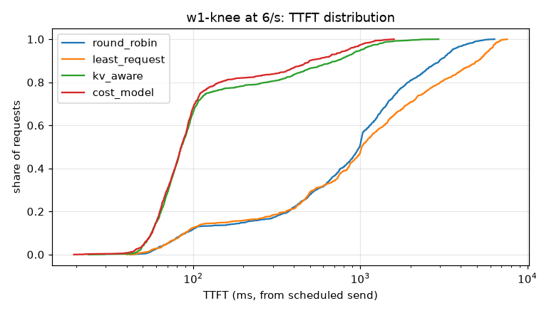
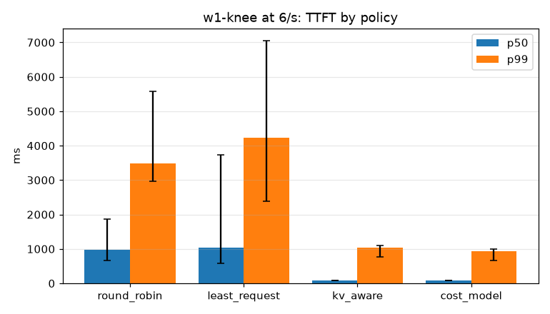

## w2: Multi turn chat

Poisson arrivals, 3 repetitions per rate, seed 0.

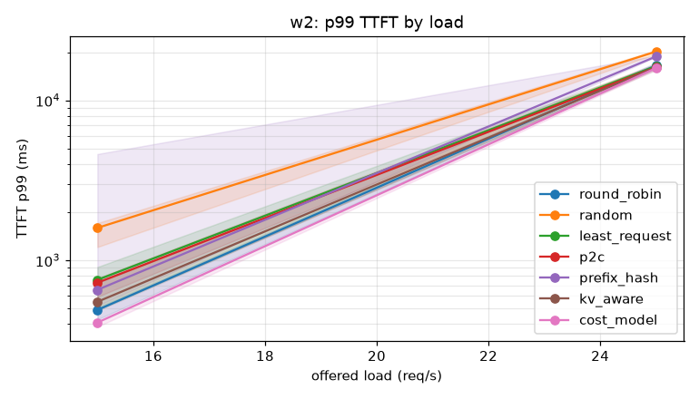
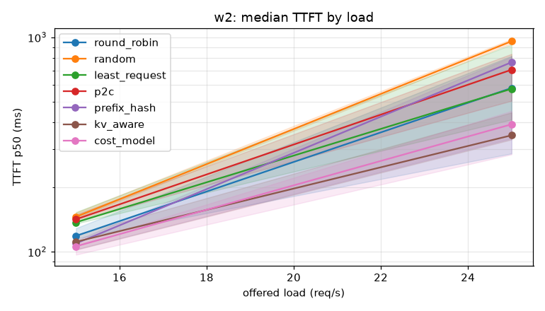
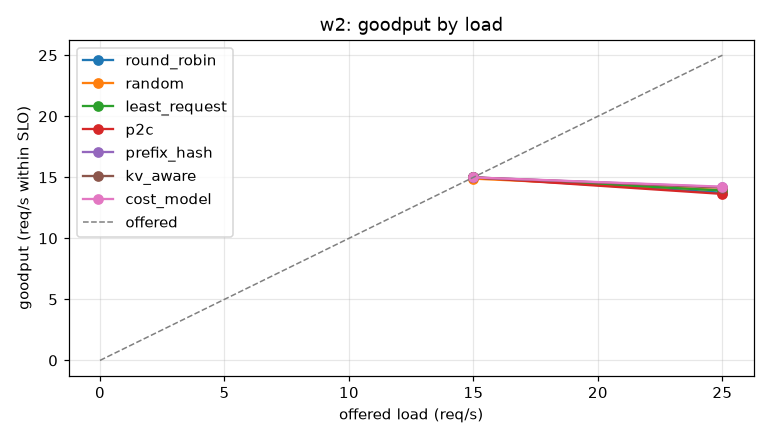

### 15 req/s, 900 requests

| policy | TTFT p50 ms | TTFT p99 ms | TPOT p50 ms | ITL p99 ms | goodput req/s | hit rate | engine hit rate | prediction agreement | max replica share | errors | send lag p99 ms |
|---|---|---|---|---|---|---|---|---|---|---|---|
| round_robin | 119 [115, 129] | 490 [427, 508] | 36.2 [35.0, 38.0] | 195.0 [186.4, 208.5] | 14.99 [14.24, 15.82] | 0.08 [0.08, 0.10] | 0.08 [0.08, 0.10] | 0.93 [0.93, 0.94] | 0.33 | 0 | 3.5 [3.5, 4.7] |
| random | 146 [143, 152] | 1598 [1213, 1710] | 36.9 [36.2, 37.4] | 238.0 [237.6, 239.3] | 14.89 [14.16, 15.82] | 0.08 [0.08, 0.09] | 0.08 [0.08, 0.09] | 0.92 [0.90, 0.93] | 0.36 | 0 | 4.0 [3.8, 4.2] |
| least_request | 137 [135, 153] | 756 [487, 909] | 36.0 [34.7, 39.2] | 236.1 [217.4, 237.0] | 14.99 [14.24, 15.82] | 0.09 [0.07, 0.09] | 0.09 [0.07, 0.09] | 0.93 | 0.34 | 0 | 3.8 [3.7, 3.9] |
| p2c | 142 [139, 149] | 726 [593, 774] | 35.5 [34.8, 37.5] | 236.1 [235.9, 238.0] | 14.99 [14.24, 15.82] | 0.08 [0.07, 0.11] | 0.08 [0.07, 0.11] | 0.93 [0.92, 0.94] | 0.34 | 0 | 4.1 [3.4, 6.1] |
| prefix_hash | 109 [102, 113] | 655 [521, 4623] | 30.7 [29.9, 32.9] | 233.7 [194.4, 237.8] | 14.99 [12.82, 15.82] | 0.25 [0.24, 0.29] | 0.24 [0.24, 0.29] | 0.84 [0.83, 0.86] | 0.35 [0.34, 0.41] | 0 | 3.6 [3.4, 3.8] |
| kv_aware | 111 [102, 120] | 552 [495, 726] | 29.8 [29.8, 33.0] | 223.0 [198.8, 234.7] | 14.99 [14.24, 15.82] | 0.23 [0.22, 0.27] | 0.23 [0.22, 0.27] | 0.85 [0.84, 0.87] | 0.34 | 0 | 4.0 [3.6, 4.3] |
| cost_model | 106 [97, 108] | 409 [385, 485] | 31.4 [29.8, 31.5] | 191.7 [187.8, 197.7] | 14.99 [14.24, 15.82] | 0.23 [0.21, 0.26] | 0.23 [0.21, 0.26] | 0.86 [0.86, 0.89] | 0.34 [0.33, 0.34] | 0 | 3.7 [3.3, 5.1] |

### 25 req/s, 1500 requests

| policy | TTFT p50 ms | TTFT p99 ms | TPOT p50 ms | ITL p99 ms | goodput req/s | hit rate | engine hit rate | prediction agreement | max replica share | errors | send lag p99 ms |
|---|---|---|---|---|---|---|---|---|---|---|---|
| round_robin | 580 [287, 818] | 16551 [15977, 17213] | 60.2 [59.8, 60.8] | 242.7 [242.3, 243.4] | 13.74 [13.26, 13.75] | 0.03 [0.02, 0.03] | 0.03 [0.02, 0.03] | 0.95 [0.95, 0.96] | 0.33 | 0 | 6.6 [5.8, 8.0] |
| random | 958 [935, 981] | 20214 [19553, 20651] | 59.7 [59.0, 59.8] | 242.9 [242.5, 243.0] | 13.95 [13.05, 14.15] | 0.02 [0.02, 0.04] | 0.02 [0.02, 0.04] | 0.95 [0.95, 0.96] | 0.36 | 0 | 6.7 [5.1, 7.5] |
| least_request | 575 [413, 924] | 16383 [15927, 16719] | 59.7 [59.5, 60.2] | 242.7 [242.3, 243.1] | 13.91 [13.28, 14.01] | 0.03 [0.02, 0.03] | 0.03 [0.02, 0.03] | 0.96 [0.95, 0.96] | 0.34 [0.33, 0.34] | 0 | 6.3 [5.8, 7.4] |
| p2c | 706 [506, 836] | 16153 [16127, 16941] | 59.9 [59.4, 60.2] | 242.9 [242.6, 243.0] | 13.64 [13.32, 14.09] | 0.02 | 0.02 | 0.96 | 0.34 | 0 | 6.3 [6.1, 8.2] |
| prefix_hash | 765 [337, 811] | 18839 [18744, 19044] | 58.8 [57.4, 59.5] | 243.9 [242.9, 244.1] | 14.19 [13.95, 14.47] | 0.08 [0.07, 0.08] | 0.08 [0.07, 0.08] | 0.87 [0.86, 0.87] | 0.36 [0.35, 0.37] | 0 | 6.2 [5.5, 6.4] |
| kv_aware | 349 [333, 446] | 16127 [15522, 16332] | 58.4 [57.5, 59.3] | 243.0 [241.0, 243.0] | 14.15 [13.83, 14.69] | 0.06 [0.06, 0.07] | 0.06 [0.06, 0.07] | 0.88 [0.87, 0.88] | 0.34 | 0 | 7.2 [6.4, 8.2] |
| cost_model | 393 [284, 453] | 15949 [15660, 16312] | 58.8 [57.9, 59.4] | 242.4 [242.4, 242.8] | 14.23 [13.77, 14.48] | 0.06 [0.05, 0.06] | 0.06 [0.05, 0.06] | 0.90 [0.89, 0.91] | 0.34 [0.33, 0.34] | 0 | 6.2 [5.7, 6.8] |

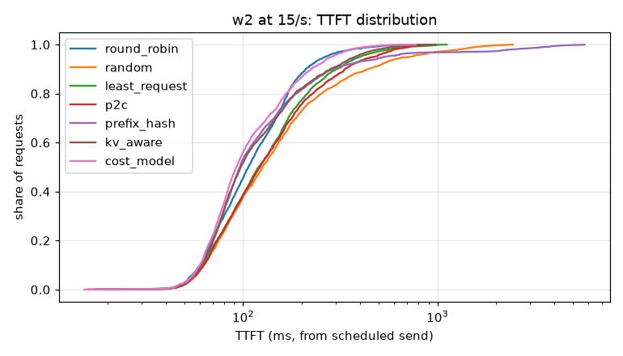
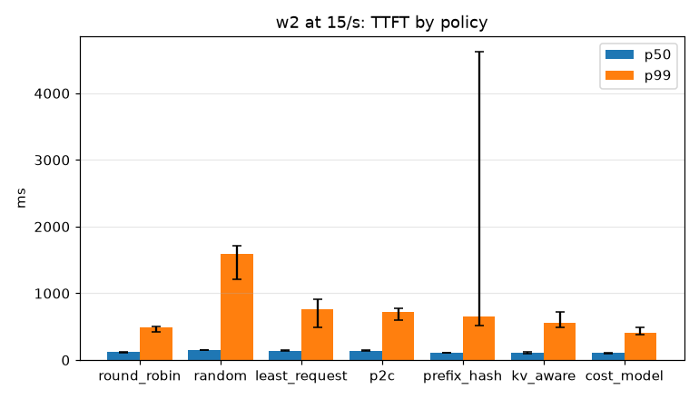

## w3: Agent loop

Poisson arrivals, 3 repetitions per rate, seed 0.

### 3 req/s, 180 requests

| policy | TTFT p50 ms | TTFT p99 ms | TPOT p50 ms | ITL p99 ms | goodput req/s | hit rate | engine hit rate | prediction agreement | max replica share | errors | send lag p99 ms |
|---|---|---|---|---|---|---|---|---|---|---|---|
| round_robin | 746 [513, 830] | 8778 [6709, 16142] | 33.2 [32.2, 48.9] | 306.3 [306.1, 320.0] | 2.01 [1.76, 2.29] | 0.55 [0.55, 0.56] | 0.55 [0.55, 0.56] | 0.91 [0.90, 0.93] | 0.33 [0.33, 0.34] | 0 | 2.5 [2.4, 2.7] |
| random | 904 [810, 1189] | 14625 [12756, 19739] | 39.3 [37.5, 40.9] | 306.7 [305.2, 320.5] | 2.14 [1.50, 2.32] | 0.55 [0.49, 0.56] | 0.55 [0.50, 0.56] | 0.90 [0.87, 0.93] | 0.36 [0.36, 0.37] | 0 | 2.6 [2.4, 2.9] |
| least_request | 756 [744, 882] | 8030 [7079, 10418] | 35.2 [34.6, 36.8] | 307.2 [305.9, 321.8] | 1.88 [1.87, 2.43] | 0.57 | 0.57 | 0.90 [0.89, 0.90] | 0.35 | 0 | 2.5 [2.4, 2.7] |
| p2c | 755 [717, 838] | 8957 [6661, 15009] | 36.1 [34.8, 36.9] | 311.4 [307.6, 318.4] | 2.14 [1.91, 2.15] | 0.53 [0.53, 0.59] | 0.54 [0.53, 0.59] | 0.92 [0.90, 0.93] | 0.35 [0.34, 0.37] | 0 | 2.4 [2.4, 2.8] |
| prefix_hash | 8461 [216, 17823] | 79786 [20946, 106775] | 75.4 [26.5, 80.7] | 306.7 [304.0, 322.0] | 1.21 [0.86, 2.14] | 0.45 [0.44, 0.75] | 0.45 [0.44, 0.75] | 0.87 [0.86, 0.87] | 1.00 [0.61, 1.00] | 0 | 2.6 [2.4, 2.7] |
| kv_aware | 241 [239, 255] | 2443 [2312, 5572] | 22.8 [22.6, 23.0] | 259.9 [222.1, 266.2] | 2.84 [2.74, 3.13] | 0.78 [0.76, 0.81] | 0.78 [0.76, 0.81] | 0.97 [0.95, 0.97] | 0.35 [0.34, 0.35] | 0 | 2.4 [2.4, 2.6] |
| cost_model | 184 [174, 187] | 1524 [1470, 1687] | 22.8 [22.6, 22.9] | 187.8 [180.7, 195.3] | 3.03 [2.85, 3.15] | 0.88 [0.87, 0.90] | 0.87 [0.87, 0.90] | 0.99 [0.97, 0.99] | 0.40 [0.37, 0.42] | 0 | 2.4 [2.4, 2.8] |

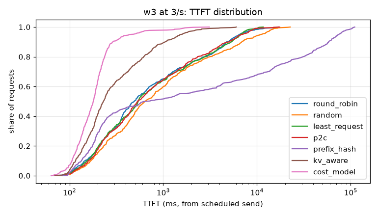
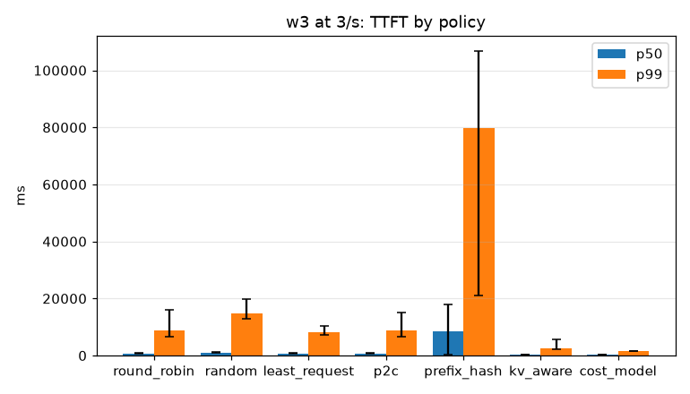

## w3-knee: Agent loop

Poisson arrivals, 3 repetitions per rate, seed 0.

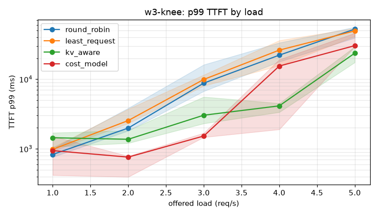
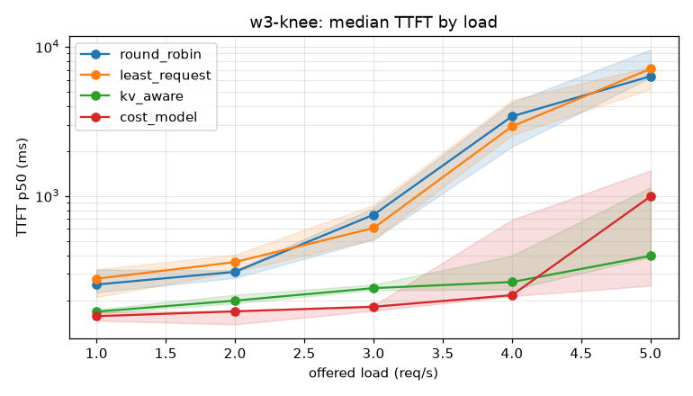
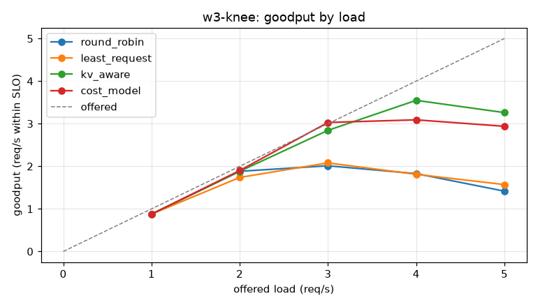

### 1 req/s, 60 requests

| policy | TTFT p50 ms | TTFT p99 ms | TPOT p50 ms | ITL p99 ms | goodput req/s | hit rate | engine hit rate | prediction agreement | max replica share | errors | send lag p99 ms |
|---|---|---|---|---|---|---|---|---|---|---|---|
| round_robin | 255 [226, 321] | 830 [761, 1003] | 20.0 | 22.5 [22.4, 22.6] | 0.88 [0.78, 1.06] | 0.72 [0.69, 0.73] | 0.72 [0.69, 0.73] | 1.00 | 0.35 [0.34, 0.35] | 0 | 2.5 [2.5, 2.8] |
| least_request | 279 [209, 321] | 981 [930, 1044] | 20.0 | 22.4 [22.4, 22.5] | 0.88 [0.78, 1.06] | 0.73 [0.67, 0.73] | 0.73 [0.67, 0.73] | 1.00 | 0.36 [0.35, 0.41] | 0 | 2.7 [2.6, 3.4] |
| kv_aware | 168 [163, 173] | 1442 [1069, 1699] | 20.0 | 22.5 [22.3, 22.6] | 0.88 [0.78, 1.06] | 0.76 [0.76, 0.83] | 0.76 [0.76, 0.82] | 1.00 | 0.37 [0.34, 0.39] | 0 | 2.5 [2.5, 2.6] |
| cost_model | 156 [146, 167] | 942 [418, 1520] | 20.0 [20.0, 20.6] | 22.7 [22.6, 23.2] | 0.88 [0.78, 1.06] | 0.87 [0.81, 0.87] | 0.87 [0.81, 0.87] | 1.00 | 0.49 [0.40, 0.59] | 0 | 2.5 [2.5, 3.1] |

### 2 req/s, 120 requests

| policy | TTFT p50 ms | TTFT p99 ms | TPOT p50 ms | ITL p99 ms | goodput req/s | hit rate | engine hit rate | prediction agreement | max replica share | errors | send lag p99 ms |
|---|---|---|---|---|---|---|---|---|---|---|---|
| round_robin | 310 [282, 318] | 1986 [1815, 3835] | 22.2 [21.1, 22.9] | 260.5 [215.4, 279.7] | 1.88 [1.76, 1.95] | 0.66 [0.66, 0.72] | 0.66 [0.66, 0.72] | 0.96 [0.96, 0.99] | 0.34 [0.33, 0.34] | 0 | 2.5 [2.4, 2.5] |
| least_request | 360 [310, 403] | 2545 [2321, 3719] | 21.0 [21.0, 22.3] | 281.3 [275.6, 292.7] | 1.74 [1.72, 1.97] | 0.63 [0.61, 0.70] | 0.63 [0.61, 0.70] | 0.96 [0.90, 0.97] | 0.35 | 0 | 2.4 [2.4, 2.5] |
| kv_aware | 199 [190, 217] | 1370 [1206, 1835] | 20.4 [20.1, 21.5] | 48.3 [34.7, 113.1] | 1.88 [1.77, 2.05] | 0.81 [0.76, 0.82] | 0.81 [0.76, 0.82] | 0.99 [0.98, 0.99] | 0.35 [0.34, 0.35] | 0 | 2.4 [2.4, 2.5] |
| cost_model | 168 [138, 170] | 760 [395, 785] | 21.1 [20.8, 21.8] | 96.8 [42.9, 117.0] | 1.90 [1.77, 2.05] | 0.88 [0.87, 0.90] | 0.88 [0.87, 0.90] | 1.00 | 0.39 [0.36, 0.42] | 0 | 2.6 [2.4, 2.6] |

### 3 req/s, 180 requests

| policy | TTFT p50 ms | TTFT p99 ms | TPOT p50 ms | ITL p99 ms | goodput req/s | hit rate | engine hit rate | prediction agreement | max replica share | errors | send lag p99 ms |
|---|---|---|---|---|---|---|---|---|---|---|---|
| round_robin | 747 [510, 829] | 8780 [6709, 16141] | 33.3 [32.3, 49.0] | 306.5 [305.0, 320.8] | 2.01 [1.76, 2.29] | 0.55 [0.55, 0.56] | 0.55 [0.55, 0.56] | 0.91 [0.90, 0.93] | 0.33 [0.33, 0.34] | 0 | 1.8 [1.7, 2.5] |
| least_request | 609 [511, 869] | 9910 [8021, 11516] | 34.4 [29.6, 34.6] | 306.0 [304.5, 318.5] | 2.08 [1.88, 2.45] | 0.57 | 0.58 [0.57, 0.58] | 0.90 [0.89, 0.96] | 0.35 [0.34, 0.36] | 0 | 1.6 [1.5, 2.4] |
| kv_aware | 241 [233, 254] | 3037 [2310, 5570] | 22.7 [22.6, 23.0] | 259.8 [243.3, 264.3] | 2.84 [2.79, 3.13] | 0.78 [0.76, 0.82] | 0.78 [0.76, 0.82] | 0.95 [0.95, 0.97] | 0.35 | 0 | 1.8 [1.5, 2.9] |
| cost_model | 181 [170, 184] | 1526 [1467, 1685] | 22.8 [22.5, 22.8] | 187.7 [182.2, 193.5] | 3.03 [2.85, 3.15] | 0.88 [0.87, 0.90] | 0.87 [0.87, 0.90] | 0.99 [0.97, 0.99] | 0.40 [0.37, 0.42] | 0 | 1.7 [1.5, 2.4] |

### 4 req/s, 240 requests

| policy | TTFT p50 ms | TTFT p99 ms | TPOT p50 ms | ITL p99 ms | goodput req/s | hit rate | engine hit rate | prediction agreement | max replica share | errors | send lag p99 ms |
|---|---|---|---|---|---|---|---|---|---|---|---|
| round_robin | 3413 [2138, 4229] | 22138 [17817, 33347] | 72.4 [64.2, 73.7] | 320.1 [306.7, 327.2] | 1.83 [1.53, 1.91] | 0.47 [0.47, 0.48] | 0.47 [0.47, 0.49] | 0.86 [0.86, 0.88] | 0.33 | 0 | 2.5 [2.3, 2.6] |
| least_request | 2924 [2555, 4384] | 26140 [15620, 36013] | 64.7 [63.0, 72.2] | 319.2 [307.3, 333.3] | 1.81 [1.47, 1.91] | 0.49 [0.49, 0.51] | 0.49 [0.49, 0.51] | 0.88 [0.87, 0.89] | 0.35 [0.34, 0.35] | 0 | 2.7 [2.7, 2.8] |
| kv_aware | 265 [236, 398] | 4138 [3356, 4506] | 26.1 [25.5, 26.5] | 302.9 [278.7, 304.5] | 3.55 [3.50, 3.84] | 0.78 [0.77, 0.81] | 0.78 [0.77, 0.81] | 0.88 [0.87, 0.94] | 0.35 [0.33, 0.35] | 0 | 2.5 [2.4, 2.6] |
| cost_model | 216 [213, 692] | 15437 [1900, 19112] | 25.6 [25.3, 38.1] | 317.1 [263.8, 329.0] | 3.09 [2.31, 4.01] | 0.73 [0.60, 0.83] | 0.73 [0.60, 0.83] | 0.95 [0.92, 0.96] | 0.38 [0.35, 0.44] | 0 | 2.8 [2.7, 2.9] |

### 5 req/s, 300 requests

| policy | TTFT p50 ms | TTFT p99 ms | TPOT p50 ms | ITL p99 ms | goodput req/s | hit rate | engine hit rate | prediction agreement | max replica share | errors | send lag p99 ms |
|---|---|---|---|---|---|---|---|---|---|---|---|
| round_robin | 6335 [6223, 9545] | 52392 [39157, 55935] | 79.4 [79.4, 84.5] | 324.3 [317.9, 327.6] | 1.42 [1.41, 1.53] | 0.40 [0.39, 0.43] | 0.41 [0.39, 0.43] | 0.90 [0.86, 0.91] | 0.33 [0.33, 0.34] | 0 | 2.7 [2.5, 3.0] |
| least_request | 7107 [5193, 7332] | 49355 [41260, 53818] | 81.7 [80.5, 82.7] | 327.2 [316.1, 328.1] | 1.57 [1.04, 1.73] | 0.41 [0.40, 0.41] | 0.41 [0.40, 0.41] | 0.91 [0.89, 0.91] | 0.34 [0.33, 0.35] | 0 | 2.7 [2.6, 2.9] |
| kv_aware | 397 [389, 1143] | 23656 [17417, 29258] | 35.3 [34.0, 37.5] | 323.7 [313.6, 325.8] | 3.26 [2.79, 3.36] | 0.68 [0.67, 0.69] | 0.68 [0.67, 0.69] | 0.85 [0.81, 0.85] | 0.35 [0.34, 0.35] | 0 | 2.7 [2.5, 13.7] |
| cost_model | 991 [250, 1481] | 30322 [29430, 45846] | 53.4 [30.7, 53.6] | 323.0 [317.2, 328.1] | 2.94 [2.75, 3.38] | 0.56 [0.53, 0.63] | 0.56 [0.53, 0.63] | 0.90 [0.87, 0.91] | 0.37 [0.37, 0.39] | 0 | 2.5 [2.4, 15.0] |

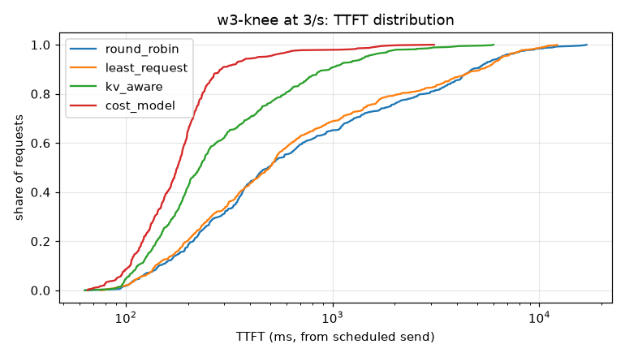
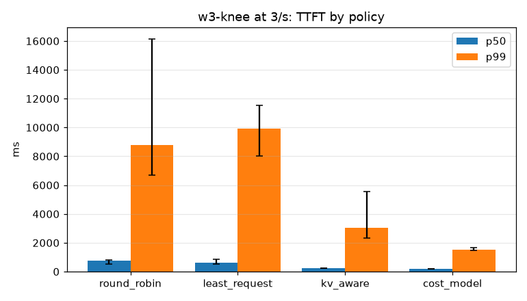

## w4: RAG over popular documents

Poisson arrivals, 3 repetitions per rate, seed 0.

### 9 req/s, 540 requests

| policy | TTFT p50 ms | TTFT p99 ms | TPOT p50 ms | ITL p99 ms | goodput req/s | hit rate | engine hit rate | prediction agreement | max replica share | errors | send lag p99 ms |
|---|---|---|---|---|---|---|---|---|---|---|---|
| round_robin | 207 [198, 211] | 593 [569, 718] | 35.2 [33.9, 35.4] | 238.2 [237.6, 239.3] | 9.01 [8.71, 9.06] | 0.21 [0.15, 0.21] | 0.21 [0.15, 0.21] | 0.98 [0.98, 0.99] | 0.33 | 0 | 3.2 [2.6, 3.3] |
| random | 261 [236, 271] | 983 [772, 1042] | 36.1 [34.4, 36.8] | 240.7 [239.7, 241.3] | 9.01 [8.71, 9.06] | 0.20 [0.16, 0.21] | 0.20 [0.16, 0.21] | 0.98 | 0.36 | 0 | 3.5 [2.8, 4.1] |
| least_request | 239 [218, 239] | 761 [717, 837] | 35.6 [34.0, 35.7] | 239.3 [238.5, 239.4] | 9.01 [8.71, 9.06] | 0.20 [0.15, 0.20] | 0.20 [0.15, 0.20] | 0.99 [0.98, 0.99] | 0.34 [0.34, 0.35] | 0 | 3.4 [3.3, 3.8] |
| p2c | 241 [228, 242] | 843 [749, 853] | 35.3 [34.3, 35.9] | 239.4 [238.7, 240.4] | 9.01 [8.71, 9.06] | 0.20 [0.16, 0.21] | 0.20 [0.16, 0.21] | 0.98 [0.97, 0.99] | 0.34 [0.34, 0.35] | 0 | 3.9 [3.0, 4.0] |
| prefix_hash | 237 [222, 247] | 889 [790, 1035] | 35.7 [35.0, 36.4] | 241.1 [240.4, 241.7] | 9.01 [8.70, 9.02] | 0.27 [0.22, 0.27] | 0.27 [0.22, 0.27] | 0.98 [0.98, 0.99] | 0.46 [0.44, 0.50] | 0 | 3.4 [2.9, 3.7] |
| kv_aware | 227 [206, 245] | 761 [749, 856] | 33.5 [32.2, 33.6] | 239.5 [238.5, 239.5] | 9.01 [8.71, 9.06] | 0.26 [0.22, 0.27] | 0.26 [0.22, 0.27] | 0.99 [0.98, 0.99] | 0.35 [0.34, 0.36] | 0 | 2.9 [2.9, 3.2] |
| cost_model | 195 [182, 196] | 512 [449, 517] | 34.5 [33.0, 34.5] | 237.6 [236.6, 238.4] | 9.01 [8.71, 9.06] | 0.25 [0.20, 0.25] | 0.25 [0.20, 0.25] | 0.98 [0.98, 0.99] | 0.34 | 0 | 3.7 [3.1, 3.8] |

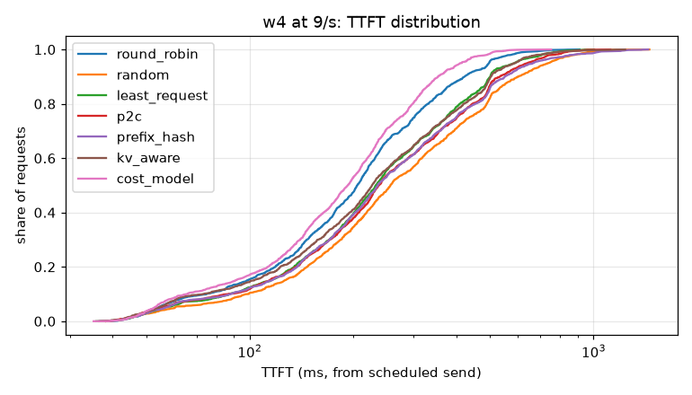
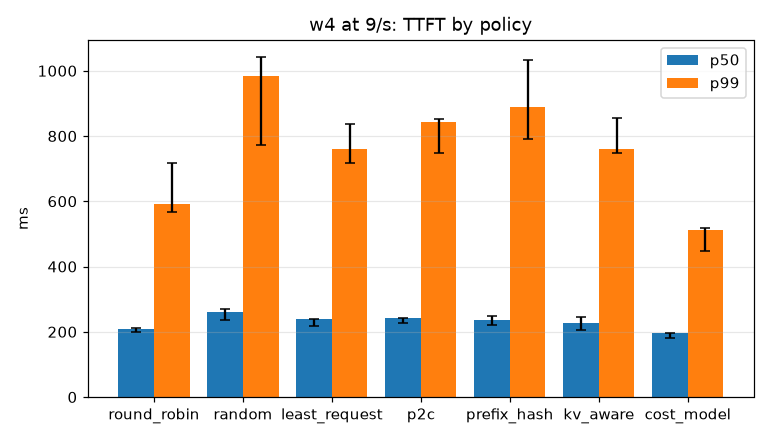

## w5: Few shot evaluation

Poisson arrivals, 3 repetitions per rate, seed 0.

### 12 req/s, 720 requests

| policy | TTFT p50 ms | TTFT p99 ms | TPOT p50 ms | ITL p99 ms | goodput req/s | hit rate | engine hit rate | prediction agreement | max replica share | errors | send lag p99 ms |
|---|---|---|---|---|---|---|---|---|---|---|---|
| round_robin | 42 | 83 [82, 85] | 20.2 [20.1, 20.2] | 56.8 [55.4, 57.9] | 12.31 [12.04, 12.35] | 0.94 | 0.94 | 1.00 | 0.33 | 0 | 2.3 |
| random | 47 [47, 50] | 123 [116, 124] | 20.6 [20.5, 21.5] | 60.1 [59.5, 60.7] | 12.31 [12.04, 12.35] | 0.94 | 0.94 | 1.00 | 0.37 [0.36, 0.37] | 0 | 2.6 [2.4, 2.7] |
| least_request | 41 [39, 41] | 91 [87, 95] | 20.1 | 56.4 [55.8, 56.5] | 12.31 [12.04, 12.35] | 0.94 | 0.94 | 1.00 | 0.35 | 0 | 2.5 [2.3, 2.5] |
| p2c | 42 [41, 43] | 97 [93, 98] | 20.1 [20.1, 20.2] | 57.3 [57.0, 57.5] | 12.31 [12.04, 12.35] | 0.94 | 0.94 | 1.00 | 0.35 [0.34, 0.36] | 0 | 2.4 [2.4, 2.5] |
| prefix_hash | 50 [49, 52] | 117 [117, 128] | 21.1 [20.9, 21.8] | 61.1 [60.0, 61.9] | 12.31 [12.04, 12.33] | 0.94 | 0.94 | 1.00 | 0.50 [0.49, 0.51] | 0 | 2.4 [2.3, 2.4] |
| kv_aware | 41 [39, 41] | 94 [93, 109] | 20.1 [20.1, 20.2] | 55.9 [55.2, 56.3] | 12.31 [12.04, 12.35] | 0.94 [0.93, 0.94] | 0.94 [0.93, 0.94] | 1.00 | 0.34 | 0 | 2.4 [2.4, 2.7] |
| cost_model | 43 [42, 43] | 92 [91, 94] | 20.2 | 57.4 [56.3, 58.1] | 12.31 [12.04, 12.35] | 0.94 | 0.94 | 1.00 | 0.37 | 0 | 2.6 [2.4, 2.9] |

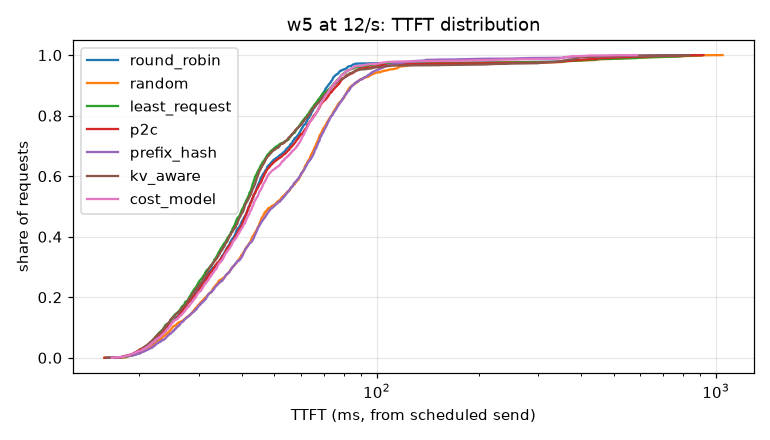
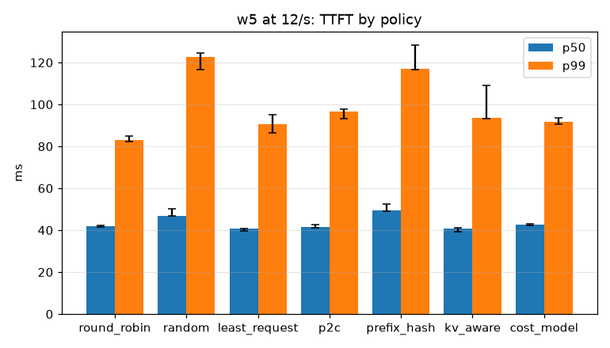

## w6: Unique prompts

Poisson arrivals, 3 repetitions per rate, seed 0.

### 9 req/s, 540 requests

| policy | TTFT p50 ms | TTFT p99 ms | TPOT p50 ms | ITL p99 ms | goodput req/s | hit rate | engine hit rate | prediction agreement | max replica share | errors | send lag p99 ms |
|---|---|---|---|---|---|---|---|---|---|---|---|
| round_robin | 452 [423, 499] | 1470 [1134, 1975] | 59.2 [57.2, 63.4] | 244.3 [243.9, 245.3] | 8.51 [8.01, 8.77] | 0.00 | 0.00 | 1.00 | 0.33 | 0 | 3.5 [3.2, 4.2] |
| random | 668 [663, 758] | 3154 [2535, 3282] | 63.6 [63.0, 70.4] | 246.6 [245.6, 246.9] | 6.87 [6.73, 7.76] | 0.00 | 0.00 | 1.00 | 0.36 | 0 | 3.7 [3.6, 3.9] |
| least_request | 503 [493, 581] | 1416 [1333, 2119] | 59.9 [58.0, 61.2] | 244.9 [243.7, 245.1] | 8.51 [8.23, 8.83] | 0.00 | 0.00 | 1.00 | 0.35 [0.34, 0.36] | 0 | 3.8 [3.5, 3.9] |
| p2c | 560 [530, 574] | 1837 [1496, 2423] | 60.4 [57.3, 61.5] | 245.9 [244.8, 246.3] | 8.41 [7.93, 8.85] | 0.00 | 0.00 | 1.00 | 0.35 | 0 | 3.2 [2.8, 3.2] |
| prefix_hash | 657 [595, 722] | 3507 [2525, 3868] | 59.8 [57.6, 70.2] | 246.9 [246.0, 247.3] | 7.60 [6.75, 7.68] | 0.00 | 0.00 | 1.00 | 0.35 [0.35, 0.36] | 0 | 4.0 [3.1, 11.8] |
| kv_aware | 498 [493, 567] | 1406 [1376, 2258] | 59.6 [57.7, 61.9] | 244.5 [243.5, 246.4] | 8.56 [7.91, 8.73] | 0.00 | 0.00 | 1.00 | 0.34 | 0 | 4.1 [3.3, 4.5] |
| cost_model | 407 [388, 496] | 909 [886, 2179] | 60.1 [59.6, 63.5] | 243.6 [242.7, 244.6] | 8.58 [8.13, 8.91] | 0.00 | 0.00 | 1.00 | 0.35 [0.34, 0.36] | 0 | 3.9 [3.8, 6.9] |

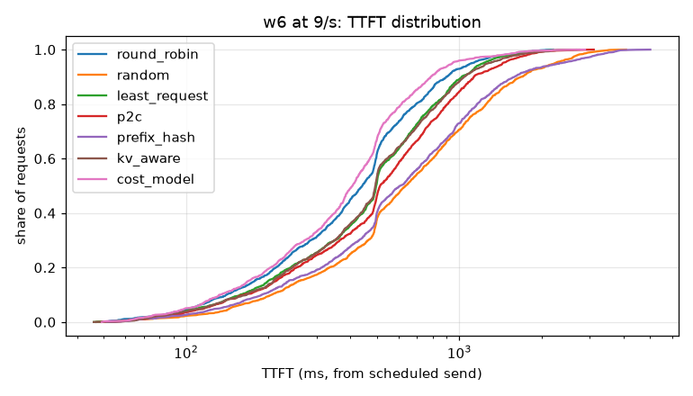
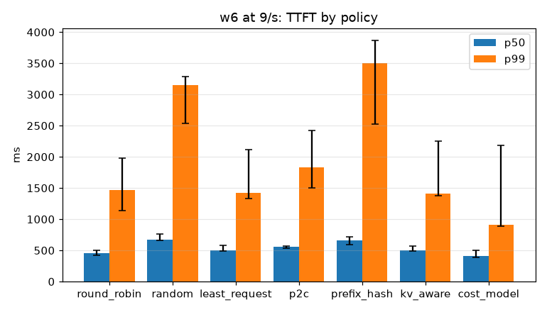

## w8-cv2: Bursty arrivals

Gamma CV 2 with a diurnal ramp arrivals, 3 repetitions per rate, seed 0.

### 5 req/s, 300 requests

| policy | TTFT p50 ms | TTFT p99 ms | TPOT p50 ms | ITL p99 ms | goodput req/s | hit rate | engine hit rate | prediction agreement | max replica share | errors | send lag p99 ms |
|---|---|---|---|---|---|---|---|---|---|---|---|
| round_robin | 2123 [635, 6444] | 6113 [4179, 18302] | 75.1 [35.8, 80.1] | 270.0 [257.0, 271.4] | 2.65 [1.35, 4.04] | 0.41 [0.37, 0.43] | 0.41 [0.37, 0.43] | 0.90 [0.87, 0.93] | 0.33 [0.33, 0.34] | 0 | 5.5 [3.7, 5.7] |
| random | 3324 [996, 6896] | 8869 [7179, 17017] | 78.2 [42.5, 78.9] | 272.2 [259.4, 272.8] | 1.69 [1.43, 3.18] | 0.37 [0.37, 0.39] | 0.37 [0.37, 0.39] | 0.91 [0.91, 0.92] | 0.34 [0.34, 0.35] | 0 | 3.9 [3.9, 4.3] |
| least_request | 2435 [751, 6718] | 6584 [5206, 19741] | 76.2 [39.6, 85.4] | 269.8 [258.6, 272.7] | 2.19 [1.71, 3.83] | 0.38 [0.32, 0.38] | 0.38 [0.32, 0.38] | 0.91 [0.91, 0.93] | 0.35 [0.35, 0.37] | 0 | 3.7 [3.5, 34.5] |
| p2c | 2656 [744, 6150] | 8523 [3702, 17524] | 76.5 [39.3, 84.3] | 272.4 [259.2, 273.9] | 1.96 [1.96, 3.78] | 0.37 [0.34, 0.42] | 0.37 [0.34, 0.42] | 0.91 [0.89, 0.92] | 0.34 [0.34, 0.35] | 0 | 5.0 [3.6, 12.9] |
| prefix_hash | 127 [92, 131] | 1357 [803, 2347] | 24.0 [21.6, 24.3] | 255.7 [84.4, 260.8] | 6.25 [4.44, 9.30] | 0.89 [0.82, 0.90] | 0.89 [0.82, 0.90] | 0.95 [0.95, 0.98] | 0.46 [0.42, 0.49] | 0 | 4.4 [3.1, 4.4] |
| kv_aware | 105 [96, 108] | 1126 [933, 1367] | 22.3 [21.3, 23.9] | 210.9 [81.7, 235.5] | 6.39 [4.44, 9.30] | 0.85 [0.84, 0.88] | 0.85 [0.84, 0.88] | 0.98 [0.95, 0.99] | 0.36 [0.34, 0.41] | 0 | 3.5 [3.0, 4.4] |
| cost_model | 103 [93, 117] | 1012 [689, 1402] | 22.5 [21.5, 26.0] | 239.3 [101.8, 246.0] | 6.39 [4.44, 9.30] | 0.85 [0.84, 0.88] | 0.85 [0.84, 0.88] | 0.97 | 0.35 [0.35, 0.36] | 0 | 3.4 [3.2, 4.4] |

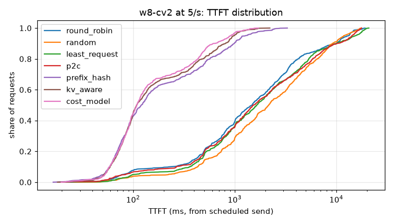
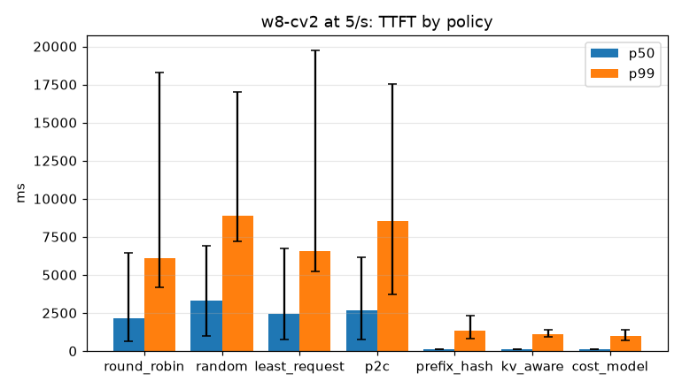

## w8-cv4: Bursty arrivals

Gamma CV 4 with a diurnal ramp arrivals, 3 repetitions per rate, seed 0.

### 5 req/s, 300 requests

| policy | TTFT p50 ms | TTFT p99 ms | TPOT p50 ms | ITL p99 ms | goodput req/s | hit rate | engine hit rate | prediction agreement | max replica share | errors | send lag p99 ms |
|---|---|---|---|---|---|---|---|---|---|---|---|
| round_robin | 5844 [2236, 8999] | 16514 [8525, 16555] | 76.8 [73.0, 80.4] | 272.4 [264.7, 273.3] | 1.03 [0.23, 1.49] | 0.37 [0.35, 0.38] | 0.37 [0.35, 0.38] | 0.89 [0.88, 0.92] | 0.33 [0.33, 0.34] | 0 | 7.5 [6.6, 8.5] |
| random | 7093 [2323, 8474] | 16015 [9158, 19178] | 79.9 [66.0, 82.4] | 270.8 [262.0, 272.1] | 0.86 [0.47, 1.44] | 0.37 [0.37, 0.38] | 0.38 [0.36, 0.38] | 0.89 [0.88, 0.90] | 0.34 [0.34, 0.35] | 0 | 11.5 [8.4, 23.4] |
| least_request | 6259 [2026, 8700] | 14936 [8284, 16807] | 82.1 [64.4, 83.3] | 270.9 [267.1, 271.7] | 0.63 [0.50, 1.52] | 0.37 [0.35, 0.41] | 0.37 [0.34, 0.41] | 0.89 [0.89, 0.90] | 0.35 [0.34, 0.36] | 0 | 8.9 [7.7, 11.9] |
| p2c | 6276 [1705, 6296] | 13570 [9455, 15437] | 76.0 [63.5, 81.9] | 271.4 [265.2, 272.7] | 0.63 [0.53, 1.88] | 0.43 [0.35, 0.43] | 0.41 [0.35, 0.42] | 0.90 [0.89, 0.91] | 0.35 [0.34, 0.36] | 0 | 8.4 [6.4, 9.1] |
| prefix_hash | 220 [183, 732] | 4588 [1336, 5447] | 24.2 [22.3, 25.8] | 266.6 [151.6, 280.0] | 5.05 [3.66, 6.31] | 0.88 [0.84, 0.90] | 0.88 [0.81, 0.90] | 0.94 [0.92, 0.98] | 0.46 [0.42, 0.48] | 0 | 6.2 [6.1, 9.8] |
| kv_aware | 207 [164, 328] | 1410 [1404, 2963] | 23.6 [22.7, 25.5] | 183.3 [144.5, 259.9] | 6.57 [3.66, 7.14] | 0.87 [0.84, 0.88] | 0.84 [0.84, 0.88] | 0.98 [0.94, 0.99] | 0.35 [0.35, 0.39] | 0 | 7.0 [6.9, 7.0] |
| cost_model | 198 [155, 496] | 1398 [1110, 2002] | 25.4 [22.5, 33.0] | 248.4 [214.1, 262.8] | 7.17 [3.66, 7.48] | 0.87 [0.79, 0.89] | 0.83 [0.79, 0.89] | 0.97 [0.94, 0.99] | 0.37 [0.35, 0.41] | 0 | 7.1 [7.0, 8.8] |

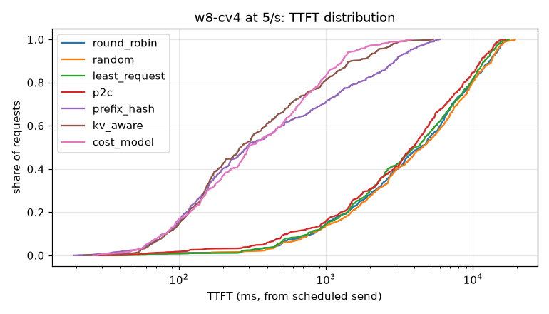
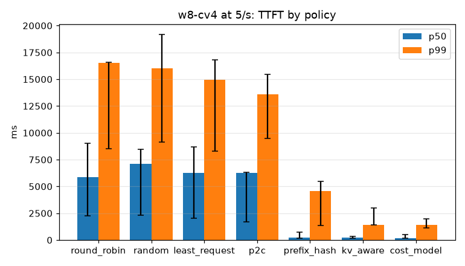

## w8-poisson: Bursty arrivals

Poisson with a diurnal ramp arrivals, 3 repetitions per rate, seed 0.

### 5 req/s, 300 requests

| policy | TTFT p50 ms | TTFT p99 ms | TPOT p50 ms | ITL p99 ms | goodput req/s | hit rate | engine hit rate | prediction agreement | max replica share | errors | send lag p99 ms |
|---|---|---|---|---|---|---|---|---|---|---|---|
| round_robin | 1959 [1566, 2657] | 6680 [6534, 7202] | 75.2 [74.1, 78.9] | 271.8 [263.1, 272.0] | 2.76 [1.90, 3.18] | 0.41 [0.40, 0.43] | 0.41 [0.40, 0.43] | 0.90 [0.88, 0.91] | 0.33 | 0 | 2.7 [1.6, 2.8] |
| random | 3311 [1992, 4900] | 8723 [7690, 10041] | 77.5 [71.6, 83.3] | 269.2 [264.5, 270.3] | 1.32 [0.78, 2.80] | 0.37 [0.36, 0.41] | 0.37 [0.36, 0.41] | 0.90 [0.89, 0.91] | 0.34 [0.34, 0.35] | 0 | 2.8 [2.3, 3.5] |
| least_request | 1995 [1673, 4276] | 7049 [5881, 10547] | 75.5 [74.2, 78.6] | 269.4 [264.4, 270.6] | 2.92 [0.53, 3.24] | 0.39 [0.38, 0.42] | 0.39 [0.38, 0.42] | 0.90 [0.90, 0.91] | 0.36 [0.34, 0.40] | 0 | 3.5 [3.2, 3.6] |
| p2c | 1773 [1076, 5367] | 6136 [3623, 9451] | 74.9 [71.2, 80.2] | 271.0 [262.0, 272.2] | 3.03 [0.77, 4.54] | 0.37 [0.36, 0.43] | 0.37 [0.37, 0.42] | 0.92 [0.89, 0.92] | 0.35 [0.33, 0.36] | 0 | 3.3 [2.9, 3.6] |
| prefix_hash | 86 [82, 95] | 1327 [917, 1911] | 22.8 [22.5, 24.6] | 239.1 [104.7, 256.8] | 6.21 [5.96, 6.26] | 0.87 [0.82, 0.89] | 0.87 [0.82, 0.88] | 0.96 [0.94, 0.98] | 0.46 [0.42, 0.49] | 0 | 2.5 [2.4, 2.7] |
| kv_aware | 86 [82, 87] | 1039 [832, 1171] | 22.5 [22.4, 22.5] | 85.0 [83.3, 234.5] | 6.21 [5.98, 6.26] | 0.85 [0.85, 0.87] | 0.85 [0.84, 0.87] | 0.98 [0.97, 0.99] | 0.35 | 0 | 2.4 [2.3, 2.5] |
| cost_model | 85 [80, 85] | 1024 [731, 1064] | 22.5 [22.4, 22.7] | 233.7 [87.5, 241.5] | 6.21 [5.98, 6.26] | 0.85 [0.85, 0.89] | 0.85 [0.84, 0.88] | 0.97 [0.95, 0.99] | 0.35 [0.34, 0.37] | 0 | 2.6 [2.4, 2.7] |

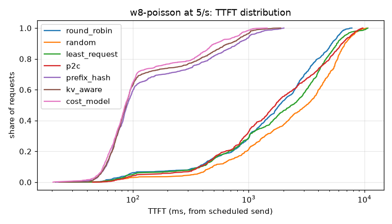
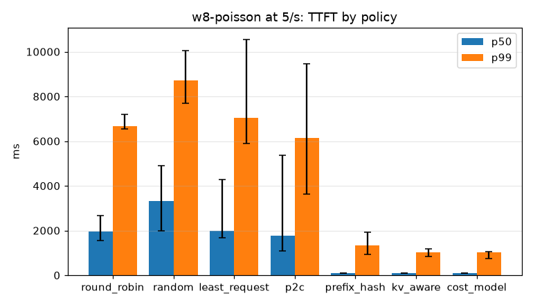

## Environment

* 372 runs, 146,099 measured requests, 0 failed.
* Commits: 6fd2d145671f; 0 runs from a dirty tree.
* Binaries: inferrail-gateway 0.1.10; inferrail-sim 0.1.10.
* Simulator flags: `--enable-prompt-tokens-details`.
* Platform: macOS-26.6.2-arm64-arm-64bit, 10 cpus.
